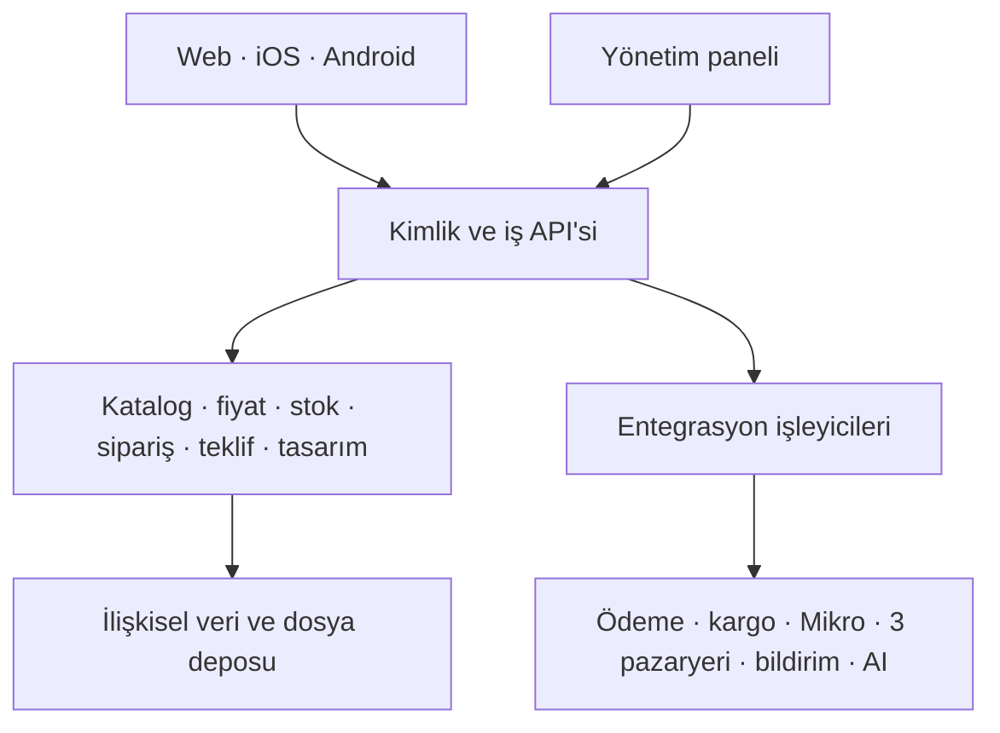

# Xinobi — Kavramsal ve Teknik Analiz

**Durum:** Temsili uzman incelemesi tamamlandı; ürün kararları açık · **Tarih:** 28 Eylül 2026  
**Kaynak:** `Xinobi_Proje_Kapsami(4).md` (kullanıcının sağladığı kapsam)  
**Yöntem:** Altı temsili uzman rolünün incelemesi; gerçek çalışan, 20 yıllık gerçek iş geçmişi veya insan imzası iddiası yoktur.

## 1. Ekip, sorumluluk ve inceleme usulü

| Rol (temsili 20+ yıl uzman bakışı) | Sorumluluk | İnceleme odağı |
|---|---|---|
| Proje yöneticisi — ekip lideri | Kapsam, bağımlılıklar, karar kaydı, sprint ve kabul kapıları | Plan ve altı rolün görüşlerinin birleştirilmesi |
| İş analisti | Mevcut/hedef süreçler, aktörler, iş kuralları, UAT senaryoları | İhtiyaçların kaynağa izlenebilirliği |
| Senior frontend geliştirici | Web, yönetim paneli, responsive UI ve editör etkileşimi | Ekran akışları ve uygulanabilirlik |
| Senior backend geliştirici | API, ödeme, sipariş ve dış sistem sözleşmeleri | Tutarlılık, güvenlik, yeniden deneme |
| Veritabanı yöneticisi | Veri sahipliği, model, bütünlük, yedek ve operasyon | Ana kayıtlar ve izlenebilirlik |
| Senior full stack geliştirici | Web/mobil/API uçtan uca birleştirme, dağıtım ve doğrulama | Kanal eşliği ve canlı geçiş |

PM, her aşamanın kabul ölçütlerini rol incelemesiyle kapatır. Bu belgede **inceleme onayı** teknik metnin tutarlılığına ilişkindir; sağlayıcı sözleşmesi, ürün kararları ve gerçek kullanıcı kabulü için Xinobi yetkililerinin ayrıca karar vermesi gerekir. Altı rol, bir UI/UX tasarımcısı, iki ayrı mobil uzman, test ve operasyon ekibinin kapasitesini otomatik olarak temsil etmez; planın insan kaynağı varsayımı bu nedenle ayrıca doğrulanmalıdır.

## 2. Amaç, kapsam sınırı ve mevcut durum

**Hedef:** Xinobi'nin kurumsal görünürlüğünü, doğrudan B2C satışını, seçili ürünlerde kişiselleştirmeyi, kurumsal teklifleri, web/iOS/Android siparişlerini, Mikro muhasebeyi, Trendyol/Hepsiburada/N11 kanallarını ve iki AI işlevini tek merkezi operasyon panelinde yönetmek.

**Mevcut durum, kaynakta bildirilen kadarıyla:** Satışların önemli bölümü pazaryerlerinden geliyor. Mevcut sipariş, katalog, stok, fiyat, muhasebe ve müşteri hizmetleri süreçlerinin gerçek adımları, kullanılan yazılım sürümleri, entegrasyon erişimleri ve mevcut kodun durumu dosyada yoktur. Bunlar keşif görüşmesi ve örnek kayıtlarla doğrulanacaktır. Hedef akışlar bugünkü operasyonun kanıtlanmış tasviri değildir.

**Nihai teslim sınırı:** Kurumsal web ve CMS/SEO; B2C e-ticaret; yönetim paneli; basit kişiselleştirme ve gelişmiş editör; kurumsal teklif ve toplu sipariş; iOS/Android; Mikro; üç pazaryeri; merkezi sipariş; AI tasarım üretimi ve AI satış asistanı/yönetimi; test, eğitim ve yayın desteği. Aşamalandırma bu kalemleri kaldırmaz. Kapsamda bulunmayan yeni ERP, lojistik ağı, üretim planlama, sadakat programı veya başka satış kanalları eklenmez. Altyapı bileşenleri, yeni müşteri ürünü değil, bu teslimleri gerçekleştirme araçlarıdır.

## 3. İş aktörleri ve süreçler

| Aktör | Temel işi | Örnek yetki sınırı |
|---|---|---|
| Misafir / üye müşteri | Ürün keşfi, tasarım, sepet, ödeme, sipariş/iadeye başvuru | Yalnız kendi hesap ve siparişleri |
| Kurumsal başvuru sahibi | Firma, adet, tasarım, termin ve teslimat bilgisiyle teklif talebi | Yalnız kendi talep görünümü; hesap modeli doğrulanacak |
| Katalog ve içerik sorumlusu | Ürün, varyant, medya, sayfa, kampanya | Sipariş/entegrasyon yönetimi varsayılan olarak yok |
| Sipariş ve müşteri hizmetleri | Sipariş, kargo, iptal, iade, görüşme | Yetkili işlem ve kayıtlı gerekçe |
| Teklif sorumlusu | Teklif durumları, notları, müşteri iletişimi | Teklif akışıyla sınırlı |
| Tasarım / baskı operatörü | Tasarım kontrolü, baskı dosyası indirme | Baskı verisiyle sınırlı |
| Entegrasyon yöneticisi | Mikro/pazaryeri eşleştirme ve hata yeniden gönderimi | Kısıtlı teknik operasyon |
| AI içerik sorumlusu | Bilgi kaynağı, prompt, limit, rapor ve görüşmeler | İlgili veri erişimi; hassas veriye en az yetki |
| Süper yönetici | Rol ve ayarlar | Ayrı denetim izi; günlük işlere varsayılan erişim verilmez |

Bu satırlar kişi kadrosu değil **rol şablonudur**. Pazaryerinden gelen alıcı kendiliğinden üyelik hesabına dönüştürülmez.

### 3.1 Hedef süreç haritası

1. **Katalogdan satışa:** Panelde ürün/kategori/varyant/görsel/baskı kuralı yönetilir; stok ve fiyatın sahibi kesinleştirilir; yayın web ve mobilde görünür; uygun ürünler pazaryerlerine eşlenir. Varyant, görsel, fiyat ve stok aynı seçime bağlanır.
2. **B2C:** Müşteri ürünü ve varyantı seçer, gerekiyorsa tasarlar, sepete ekler; ödeme öncesi sunucu son fiyat, kampanya ve stok durumunu doğrular. İş kuralına göre ödeme bekleyen sipariş/ödeme girişimi kaydı açılır; kart sağlayıcısının doğruladığı işlem tek kez onaylanır, havale/EFT operatör doğrulamasına kadar ödeme bekler. Başarısız/zaman aşımına uğrayan girişimlerde stok rezervasyonu D03'te belirlenecek sürede bırakılır. Siparişin kesin oluşturulma anı, rezervasyon süresi ve duruma geçişler D03 ile onaylanır. Kanal ve ödeme kayıtları ilişkilendirilir; kargo, bilgilendirme, iptal/iade süreçleri izlenir.
3. **Kişiselleştirme:** Basit yazı/logo/görsel veya gelişmiş katmanlı editör; seçili ürünün ön/arka baskı alanı ve kalite uyarıları; canlı önizleme; tasarımın sürümü ve fiyat farkı; siparişe değişmez referans ve indirilebilir yüksek çözünürlüklü baskı çıktısı.
4. **Kurumsal:** Firma/temsilci, vergi, ürün, adet, tasarım, dosya, termin ve teslimatla teklif veya toplu sipariş talebi iletir; panelde talepler, durum/not/geçmiş ve oluşmuş toplu siparişler izlenir; e-posta gönderilir. Teklifin gerçek toplu sipariş kaydına dönüşüm ve onay yöntemi Xinobi tarafından D07'de tanımlanacaktır; salt talep ödeme emri değildir.
5. **Çok kanallı operasyon:** Üç pazaryeri siparişi kendi dış kimliği ve kanalıyla tek listede görünür; kargo, iptal/iade ve muhasebe aktarım durumları izlenir; bağlantı hataları kayda düşer ve yetkili yeniden dener.
6. **AI:** Tasarım istemi → limit/içerik kontrolü → alternatif üretimi → gerekirse arka plan kaldırma, görsel iyileştirme/genişletme ve renk varyasyonu → editöre aktarım → kullanıcı düzenlemesi. Satış asistanı güncel ürün ve onaylı içerikten arama, karşılaştırma, bütçe/adet temelli öneri, alternatif/tamamlayıcı ürün ve kampanya önerisi verir; teklif talebi ve lead açabilir, WhatsApp veya mevcut canlı destek kanalına devredebilir.

### 3.2 Örnek kullanıcı senaryoları ve kabul örnekleri

| Kim / amaç | Akış | Doğrulanacak sonuç |
|---|---|---|
| Müşteri / ürünü satın alma | Renk/varyant seç → görsel ve stok değişir → sepet → ödeme | Stoksuz varyant sepete girmez; seçilen varyant hem sepet hem siparişte kalır; ödeme öncesi fiyat/stok tekrar denetlenir. |
| Müşteri / tasarım | Baskı alanı seç → katman ekle → kaydet → tekrar aç → sipariş ver | Önizleme ile baskı alanı eşleşir; taşma ve yetersiz çözünürlük uyarısı görünür; sipariş tasarım sürümünü ve baskı dosyasını taşır. |
| Şirket / teklif | Firma, adet, termin, logo ile talep aç | Talep ID, durum ve geçmiş oluşur; teklif sorumlusu panelde işler; otomatik ücret çekilmez. |
| Operatör / pazaryeri siparişi | Dış siparişi al → eşleştir → kargola → Mikro'ya ilet | Tekrarlanan bildirim mükerrer sipariş oluşturmaz; kanal, muhasebe durumu ve hata görünür. |
| Müşteri / AI asistanı | İhtiyaç, bütçe ve adet sor → ürün karşılaştır/alternatif ve tamamlayıcı ürün ile uygun kampanya öner veya teklif yönlendir | Mevcut olmayan stok, fiyat ya da termin kesin vaat edilmez; yetkili bilgi kaynağı ve görüşme kaydı izlenir. |

## 4. İş kuralları ve karar noktaları

- Ürün ve varyant düzeyinde satışa açıklık, stok ve fiyat ayrı doğrulanır; web/mobilde görünen stok yalnız bilgilendirmedir. Ödeme ve sipariş kesinleştirme sunucuda yapılır; eş zamanlı son ürün yarışında tek sipariş kazanır veya iş kuralına göre rezervasyon yapılır.
- İndirim/kupon, kişiselleştirme fiyat farkı, kargo ve vergiler için tek hesaplama servisi uygulanır. Kampanya önceliği, havale/EFT'nin ödeme doğrulama aşaması ve stok ayırma süresi karar gerektirir.
- Sipariş durumları öneri olarak `oluşturuldu → ödeme bekliyor/onaylandı → hazırlanıyor → kargolandı → tamamlandı`; `iptal talebi / iade talebi → değerlendirildi → sonuçlandı` ayrı kayıt ve geçişlerle yönetilir. Dış kanalların kendi durum kodları eşlenir; son geçiş tablosu iş sahibiyle onaylanır.
- Tasarım yalnız kişiselleştirilebilir ürünlere bağlanır. Baskı alanı, ebat, format, DPI/kalite, font lisansı ve üretim onayı ürün/üretim ekibinin belirleyeceği kurallardır. Siparişten sonraki düzenleme mevcut baskı sürümünü geriye dönük değiştirmez.
- Pazaryeri ürün ve fiyat yayımlama kuralları kanal bazlı eşleştirilir. Kişiselleştirilmiş ürünlerin pazaryerlerinde satılıp satılmayacağı ayrı karar gerektirir.
- Sipariş/teklif/pazaryeri/AI kişisel verileri rol bazında gösterilir. İade, iptal, veri saklama ve aydınlatma metinleri için Xinobi'nin hukuk/operasyon sahiplerinden nihai metin beklenir.

### 4.1 Açık karar kaydı

| ID | Soru / kanıt | Sahip ve kapanış kapısı |
|---|---|---|
| D01 | Mevcut web, mobil, panel kodu ve veri var mı; yeniden kullanım durumu? | PM + teknik ekip, K0 |
| D02 | Ürün, varyant, fiyat, kampanya, depo/stok için hangi sistem ana kayıt; Mikro ile aktarım yönü ve öncelik ne? | Operasyon + Mikro sorumlusu, K1 |
| D03 | Sipariş, ödeme, stok rezervasyonu, havale doğrulama, iptal/iade ve kargo durumları? | Satış/operasyon, K1 |
| D04 | Baskı tekniği, fiziksel alan ölçüsü, dosya formatı, çözünürlük ve insan onayı? | Ürün/üretim, K1–K3 |
| D05 | Ödeme, kargo, e-posta/SMS, AI servisi ve mevcut canlı destek/WhatsApp kanalı sözleşme ve erişimleri? | Xinobi + PM, K0–K1 |
| D06 | Mikro sürümü, API/ara katman erişimi; üç pazaryeri mağaza ve test yetkileri? | Xinobi + entegrasyon sahipleri, K0–K4 |
| D07 | Teklifin onayı, tutarlandırılması ve siparişe dönüşümü; teklif sahibinin hesap modeli? | Kurumsal satış, K1–K3 |
| D08 | AI üretim seçenek sayısı, limit, içerik politikası, çıktıların düz görsel/katman yapısı, maliyet tavanı? | Xinobi + ürün, K3 |
| D09 | Kaynaktaki editör işlevleri iki mobil platformda korunarak etkileşim, teknik kütüphane ve performans yaklaşımı nasıl olacak; push izinleri ve mağaza yayın hesapları hazır mı? | Ürün + mobil sorumlusu, K1/K5 |
| D10 | Kurumsal/KVKK/satış metinleri, analitik rıza akışı ve veri saklama süreleri? | Xinobi hukuk/operasyon, K1/K6 |

## 5. Ekran ve yönetim deneyimi

**Web:** Ana sayfa; kurumsal ve yasal sayfalar; kategori/liste/arama/filtre/karşılaştırma; ürün detay, varyant ve kişiselleştirme; gelişmiş editör; favori, üyelik, hesap, adres, sepet/ödeme/sipariş/iade; kurumsal teklif ve toplu talep; kampanya/blog/SSS; AI asistan. Masaüstü, tablet, telefon ve klavye kullanımı denetlenir. İndekslenebilir ürün/kategori/içerik sayfalarının başlık, canonical, breadcrumb, sitemap, yapılandırılmış veri ve analitik etiketleri yönetilir.

**Panel:** Ana gösterge; kullanıcı/rol/işlem kaydı/ayar; katalog-varyant-görsel-doküman ve gerektiğinde varyant bazlı baskı alanı; fiyat-stok-depo-kampanya; müşteri, teklif, toplu sipariş, tasarım, sipariş-kargo-iade; Mikro/pazaryeri eşleştirme ve hata; içerik/SEO/medya; AI prompt-bilgi kaynağı-görüşme-lead-limit/maliyet ve temel raporlar. Kaynakta sayılan alt işlemler bu gruplarda bulunur; her işlem yetki ve denetim kaydına bağlanır.

**iOS/Android:** Kaynaktaki üyelik, katalog, arama, favori, kişiselleştirme/editör, sepet/ödeme, sipariş/profil, kurumsal talep, AI ve bildirim akışları iki platformda aynı merkezi API ve aynı kayıtlarla çalışır. Kaynakta belirtilen editör işlevleri iki mobil platformda korunur; etkileşim, kütüphane ve performans yaklaşımı D09 ile netleştirilir.

Web ve iki mobil kanalda dosya yükleme/AI üretimi için `bekliyor`, `başarısız`, `yeniden dene` ve `sonuç` durumları gösterilir; kullanıcı bir işin tamamlanmasını beklerken siparişin veya tasarımın sonucunu yanlışlıkla tamamlanmış görmez.

## 6. Teknik analiz ve mimari

### 6.1 Mantıksal bileşenler

Başlangıç için **modüler uygulama + ayrı arka plan işleyicileri** uygun tasarım önerisidir; mikroservis zorunlu değildir. Seçim, mevcut kod, ekip bilgisi ve barındırma koşulları incelendikten sonra netleşir. Web/panel ve mobil aynı iş API'sini kullanır. Dış servise giden çağrılar çevrimdışı iş kuyruğunda güvenilir tekrar ile işlenir; siparişin yerel ana kaydı dış sistem gecikmesine bağlı kalmaz. Yüklenen dosyalar ve baskı çıktıları nesne depoda, erişim referansları ilişkisel veride tutulur. Üretim, test ve geliştirme ortamları ayrılır; sırlar ortam değişkeni/gizli saklama hizmetinde tutulur. Seçilecek dil, framework, veritabanı ürünü ve bulut sağlayıcısı bu kapsam dosyasıyla belirlenmemiştir.

### 6.2 API ve işlem sözleşmeleri

- Kaynak alanları: kimlik/rol; katalog/kategori/varyant; fiyat-kampanya-kupon; stok/depo; sepet-ödeme-sipariş/iade; tasarım/şablon/baskı; teklif; CMS/SEO; AI; entegrasyon/rapor. API sürümleme, sayfalama, arama ve yetki kontrolleri tutarlı uygulanır.
- `POST /checkout` benzeri kesinleştirme komutu sunucuda stok ve tutarı tekrar hesaplar; istemci toplamına güvenmez. Tekrar basma/ağ kesilmesi için idempotency anahtarı ve ödeme sağlayıcısı işlem ID'si kullanılır. Aynı anahtarla çift checkout, tekrar ödeme bildirimi ve sağlayıcı durum sorgusu tek sipariş/ödeme kaydı ve tek stok kesinleştirmesi verir. Ödeme bildirimi doğrulanır, tekil işlem kaydına bağlanır; hata halinde durum sorgulanabilir ve süresi dolan rezervasyon bırakılır.
- Harici webhook/çekme kayıtlarında `(kanal, dış ID, olay türü/sürüm)` benzersizliği ve ham olay kimliği tutulur. Yerel sipariş değişikliği ile gönderim isteği aynı veritabanı işleminde bir *outbox* kaydına yazılır; ayrı işleyici tekrar/artan bekleme ve son hata kaydıyla iletir. Tekrar işleme yalnız güvenli durum geçişi üretir; hata, tekrar deneme sayısı ve son deneme zamanı panelde görünür. Manuel yeniden gönderim için yetki ve denetim kaydı gerekir.
- Mikro ürün/kategori aktarımı, stok/fiyat alımı, cari/sipariş/fatura/tahsilat/iade aktarımı kendi eşleme tablosu ve işlem sonucu ile izlenir. D02 çözülmeden iki tarafın aynı alanı yazmasına izin verilmez.
- Pazaryeri bağlayıcılarının her biri ürün/kategori/varyant/fiyat/stok ve sipariş/kargo/iptal/iade eşlemelerini ayrı uygular; merkezî sipariş hizmetine ortak biçimde kayıt verir. Kanal fiyatları ve eşleme hataları panelden yönetilir.
- AI tasarım işi zaman aşımına dayanıklı asenkron akıştır: `bekliyor/çalışıyor/tamamlandı/başarısız`. Limit ve içerik kontrolü sunucuda; arka plan kaldırma, iyileştirme, genişletme ve renk varyasyonu işleri ile kaynak/üretilen medya referansları kayıtlıdır. AI asistanı yalnız onaylı içerik/katalog üzerinden yanıtlar; sipariş ve stok gibi anlık veriyi güvenilir API'den okur, insan/WhatsApp devrini kaydeder. Yanıtın yanlış olabileceği akışta kesin sipariş vaadi verilmez.

### 6.3 Kavramsal veri modeli

| Küme | Temel kayıtlar ve ilişkiler | Kritik bütünlük |
|---|---|---|
| Kimlik | `User`, `Role`, `Permission`, `Customer`, `Company`, `Address` | Kullanıcı–müşteri ayrımı; yetki ve müşteri izolasyonu |
| Katalog | `Brand`, `Category`, `Product`, `Variant`, `Asset`, `ProductDocument`, `PrintArea`, `Template` | Sipariş satırı varyantı gösterir; ürün bazlı baskı kuralları |
| Ticaret | `Price`, `ChannelPrice`, `Campaign`, `Coupon`, `InventoryByWarehouse`, `InventoryMovement`, `StockReservation`, `Cart`, `Order`, `OrderLine`, `PaymentAttempt`, `Shipment`, `ReturnRequest` | Tutar/vergi ve stok hareketi geçmişi; kanal ve dış ID benzersiz |
| Tasarım | `Design`, `DesignVersion`, `DesignLayer`, `GeneratedAsset`, `PrintOutput` | Sipariş satırı değişmez tasarım sürümüne bağlanır |
| Kurumsal | `QuoteRequest`, `QuoteLine`, `QuoteNote`, `QuoteStatusHistory`, `CorporateOrderLink` | Talep ve sipariş farklı yaşam döngüleri |
| Bağlantılar | `ExternalMapping`, `IntegrationEvent`, `OutboxEvent`, `SyncJob`, `SyncAttempt`, `SyncError`, `ExternalOrderRef` | Yeniden işleme anahtarı, kaynak ve hata izi |
| İçerik ve AI | `Page`, `BlogPost`, `Menu`, `SeoMetadata`, `AiJob`, `AiConversation`, `Lead`, `KnowledgeSource`, `AiUsage` | Gizlilik, saklama ve kullanım limiti |
| Denetim | `AuditLog`, `Notification`, `SystemSetting` | Yetkili değişiklik ve durum geçmişi |

Kayıt adları mantıksal örneklerdir; fiziksel tablo tasarımı ve indeksler erişim örüntüleriyle netleşir. Fiyat, stok, sipariş ve tasarım anlık değişim için zaman damgası/sürüm taşır. Sipariş satırında satış anındaki ürün adı, varyant, adet, birim fiyat, indirim, kişiselleştirme ve vergi bileşenlerinin değişmez anlık görüntüsü tutulur; sonradan katalog değişmesi geçmiş siparişi değiştirmez. Stok hareketi/rezervasyonu atomik işlemle izlenir; depo–varyant düzeyinde eksi stok politikası belirlenir. Büyük medya ve baskı dosyaları veritabanına gömülmez. Yedek, geri yükleme denemesi, migration ve erişim günlüğü canlıya geçiş koşuludur; saklama süreleri D10'a bağlıdır.

Veritabanı düzeyinde `(kanal, dış sipariş ID)`, sağlayıcının işlem ID'si ve checkout idempotency anahtarı için uygun benzersiz kısıtlar kurulur; sipariş, ödeme ve stok kaydının tekrar güvenliği uygulama ve veri katmanlarında birlikte doğrulanır.

### 6.4 Editör ve baskı tutarlılığı

Editör katmanları (metin, görsel, şekil), sıra/görünürlük/kilit, konum, ölçek, döndürme, font ve kaynak medya kimliği sürümlü bir tasarım belgesiyle saklanır. Ön/arka yüz ve her baskı alanı fiziksel ölçü ile bir koordinat sistemi taşır; önizleme ve baskı üretimi aynı dönüştürmeyi kullanır. Geri alma/ileri alma, kaydetme/yeniden açma, taşma ve çözünürlük kontrolü tarayıcıda görünür; sipariş kesinleştirmede sunucu da kritik baskı kurallarını doğrular. Baskı dosyası formatı ve kalite eşiği D04 ile belirlenir. AI'dan gelen varlık editöre yüklenebilir görsel olarak aktarılır; katmanlara ayrılabilirliği sağlayıcı çıktısına göre ayrıca kararlaştırılır.

Renk paletindeki seçim aynı varyant kimliğiyle ürün görseli, editör, sepet ve siparişe taşınır. Ürün/varyant baskı alanı ayrımı D04'te netleşir; farklı yüzey/ölçüsü olan varyantlar için baskı alanı ayrı tanımlanır.

### 6.5 Güvenlik, kalite ve işletim

Rol bazlı erişim her API isteğinde kontrol edilir; panel işlemleri, fiyat/stok değişiklikleri, AI ayarları ve tekrar gönderimler denetlenir. Parolalar güçlü karmayla tutulur; ödeme kartı verisi uygulamada saklanmaz, sağlayıcı akışı kullanılır. Dosyalar tür/boyut ve yetki denetiminden geçer, güvenli erişim bağlantılarıyla sunulur. Trafik şifrelenir; kullanıcı girdileri doğrulanır; ödeme bildirimi ve dış webhook imzası sağlayıcının yöntemine göre doğrulanır.

Kişisel veri görünürlüğü rol ve nesne yetkisine göre sınırlanır; loglarda hassas veri maskelenir. D10 saklama süresi, metin ve rıza ayrıntılarını belirler. Ölçülebilir işletim göstergeleri: başarısız ödeme, senkron gecikmesi, stok çakışması, baskı dosyası üretim hatası, AI iş başarısı/maliyeti, API hata oranı. Kritik akışlar için otomatik doğrulama ve modül bazlı UAT yapılır; kapasite hedefi, RPO/RTO ve performans eşikleri keşifte belirlenir, bu belgede uydurulmaz.

## 7. Teslim planı ve bağımlılıklar

**Ritim önerisi:** İki haftalık sprint, PM yönetiminde demo/karar kaydı ve faz sonunda kabul kapısı. Aşağıdaki aralıklar **takvim taahhüdü değil planlama örneğidir**; altı rolün mobil, UI/UX, test ve dağıtım işlerini fiilen karşılayabilecek kapasitesi, mevcut kod ve üçüncü taraf erişimleri doğrulanınca yeniden tahmin edilir. Paralel işler olabilir; bağımlılık kapıları atlanmaz.

| Kapı / örnek sprint | Teslim ve bağımlılık | Kabul kanıtı |
|---|---|---|
| K0 · 1–2 | Mevcut operasyon, kod, veri, sözleşme, API ve baskı keşfi | D01–D06 için sahip/karar veya blokaj kaydı |
| K1 · 2–3 | Süreçler, veri sahibi, rol matrisi, durum geçişleri, UI akışları, teknik sözleşmeler | Xinobi iş sahibi kararları ve rol incelemesi |
| K2 · 3–10 | Panel/katalog/fiyat/stok + kurumsal web/B2C/ödeme/kargo/temel rapor | Test sağlayıcısıyla uçtan uca sipariş; yönetim ve müşteri ekranları |
| K3 · 11–15 | Basit kişiselleştirme, gelişmiş editör, baskı; kurumsal teklif/toplu talep | Tasarım yeniden açılır, sipariş ve baskı çıktısı eşleşir; teklif panelde izlenir |
| K4 · 16–20 | Mikro ve Trendyol, Hepsiburada, N11; merkezi çok kanallı sipariş | Her bağlayıcıda ürün/stok/kanal ve kampanyalı fiyat/sipariş/kargo/iptal/iade ve hatadan güvenli yeniden deneme; gerçek API yetenek ve erişimleriyle eşlenen farklar kayıtlı |
| K5 · 21–25 | iOS/Android ve iki AI işlevi + yönetimi; bunların tasarım/altyapısı daha erken paralel başlayabilir | Gerçek cihazda sipariş, tasarım, teklif, AI ve push; yayın hesapları hazır |
| K6 · 26–28 | Bütünleşik UAT, güvenlik/geri yükleme, veri geçişi, eğitim, canlıya ve mağazalara yayın | Kanal bazlı mutabakat, kabul tutanağı, geri alma provası, kritik hata yok |

Bu örnek 28 sprint / 56 haftalık bir sıra gösterir; efor tahmini veya altı kişinin yetişeceği garantisi değildir. Onay kapıları modülün tamamen bitmesine göre, entegrasyonlarda da sağlayıcı test ortamının ve gerçek erişimin sağlanmasına göre güncellenir. Mobil geliştirme ve AI işlerinin bir bölümü çekirdek API hazır olur olmaz paralel ilerleyebilir. Her sprintte PM açık kararları, riskleri, bağımlılıkları ve gerçekleşen kapasiteyi yeniden planlar.

K1'de D02 (ana veri sahibi), D03 (ödeme ve stok geçişleri), D04 (baskı standardı) ve D07 (kurumsal talep/sipariş) açık kalırsa bu kararlara bağlı geliştirme ve kabul kapıları ilerlemez; diğer bağımsız işler sürebilir. Hukuki metin ve saklama kararı D10'un sahibindedir, ancak erişim denetimi, şifreleme ve ödeme güvenliği gibi asgari korumalar bu kararı beklemez.

## 8. Doğrulama matrisi ve UAT

| Alan | Asgari doğrulama |
|---|---|
| Web/B2C | Gerçek ürün görseli–seçili varyant eşliği; stok bitince sepet ve checkout; kupon ve fiyat değişimi; kredi kartı ve havale akışları; aynı idempotency anahtarıyla çift checkout/ödeme bildirimi/durum sorgusunda tek sipariş, tek tahsilat ve tek stok hareketi; üyelik/şifre/adres/favori/değerlendirme; iptal/iade, SEO ve telefon/tablet erişimi |
| Panel/CMS | Her rolün izinli/yasaklı işlemi; fiyat/stok/kampanya içerik değişimi; kayıt ve temel rapor; denetim izi |
| Tasarım/baskı | Ön/arka alan; katman, hizalama, geri al/ileri al; kaydet/yeniden aç; taşma/çözünürlük; sepette sürüm ve yüksek çözünürlüklü dosya |
| Kurumsal | Firma, ürün, adet, termin, dosya; teklif ve toplu sipariş talebi durum/not/geçmiş; onaylı dönüşüm sonrası toplu sipariş takibi; e-posta; talebin yanlışlıkla ücretli siparişe dönüşmemesi |
| Mikro | Ürün/stok/fiyat/cari/sipariş/fatura/tahsilat/iade yönleri ve alan eşlemeleri; gecikme, tekrar ve manuel yeniden deneme |
| Pazaryerleri | Trendyol, Hepsiburada, N11 ayrı ayrı kategori/varyant/fiyat/stok/sipariş/kargo/iptal/iade; dış ID tekrarı ve kanal farkı |
| Mobil | iOS/Android gerçek cihazda web ile aynı müşteri verisi, ödeme, editör, bildirim, kurumsal form ve AI |
| AI | Üretim limitleri ve hata, uygunsuz istem, alternatif, arka plan kaldırma/iyileştirme/genişletme/renk varyasyonu ve editöre aktarım; yükleme/üretim bekleme-hata-yeniden deneme durumları; asistan karşılaştırma, alternatif/tamamlayıcı/kampanya, bilgi kaynağı, yanlış stok/teslimat vaadi önleme, lead/devir ve kullanım/maliyet raporu |
| Operasyon | Yedekten geri yükleme, geçiş/geri alma, bildirim hata izi, ana kayıt mutabakatı ve canlı ortam yetkisi |

**Çıkış ölçütü:** PM'nin yönettiği her kabul kapısında ilgili altı uzman bakışı kayıt altına alınır; iş sahibi tarafından verilmemiş kararlar kapanmış sayılmaz. UAT iş sahibi tarafından gerçek senaryolarla yapılır. Canlıya geçişte kritik güvenlik, ödeme, stok/sipariş veya baskı bütünlüğü hatası açık bırakılmaz.

## 9. Başlıca riskler ve azaltma

| Risk | Etki | İlk eylem |
|---|---|---|
| Mikro/pazaryeri erişimi ve sürüm farklılığı | Senkronizasyon geç başlayabilir | K0'da hesaplar, API izinleri ve örnek verilerle teknik keşif |
| Stok ve fiyat kaynak sistem belirsizliği | Yanlış satış ve çakışma | D02 kararı, tek yazma yetkisi ve mutabakat raporu |
| Baskı koşullarının geç tanımlanması | Önizleme ile üretim uyumsuzluğu | D04 için fiziksel örnek, ölçü ve çıktı kabul testi |
| Altı kişiye mobil/UIUX/test/operasyon yükü | Takvim ve kalite kayması | Kapasiteyi ölçüp iş sırası/tarih revizyonu; gerekli beceri ihtiyacını açık kaydetme |
| AI maliyeti/yanlış yanıt | Gider ve müşteri güveni | Limit, onaylı bilgi, izleme ve insan devri |
| Çoklu kanal tekrarları ve kesintileri | Çift sipariş/yanlış stok | Benzersiz dış ID, olay günlüğü, idempotency ve yeniden deneme testi |

## 10. İnceleme kaydı

Bu metin altı rolün teknik ve kavramsal incelemesinin ardından tamamlanmıştır. Rol bazlı onay **temsili değerlendirme** olarak kaydedilmiştir; gerçek insan imzası veya Xinobi'nin ticari/kullanıcı kabulü değildir. Açık D01–D10 kararları ürün sahibine bırakılmıştır; bunların kapanması uygulama tasarımının ilgili kısmı ve kesin takvim için şarttır.
