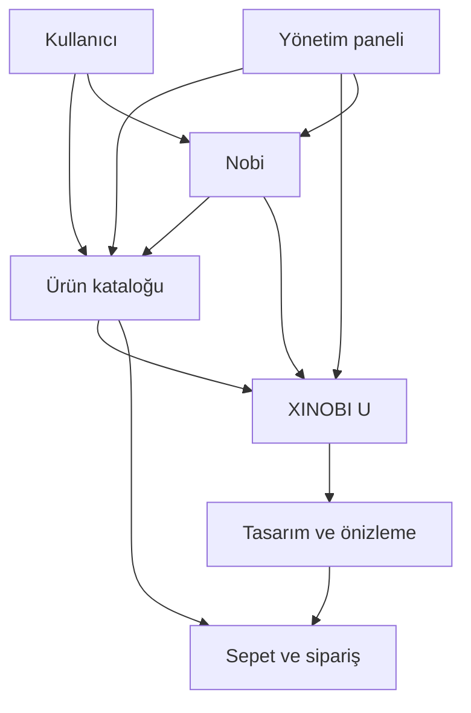
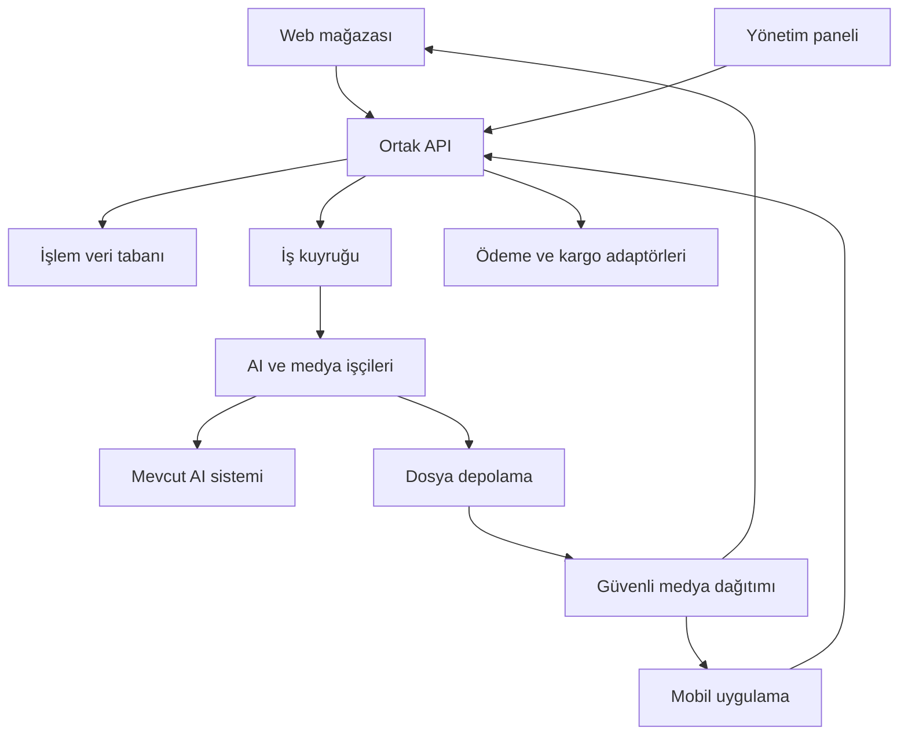
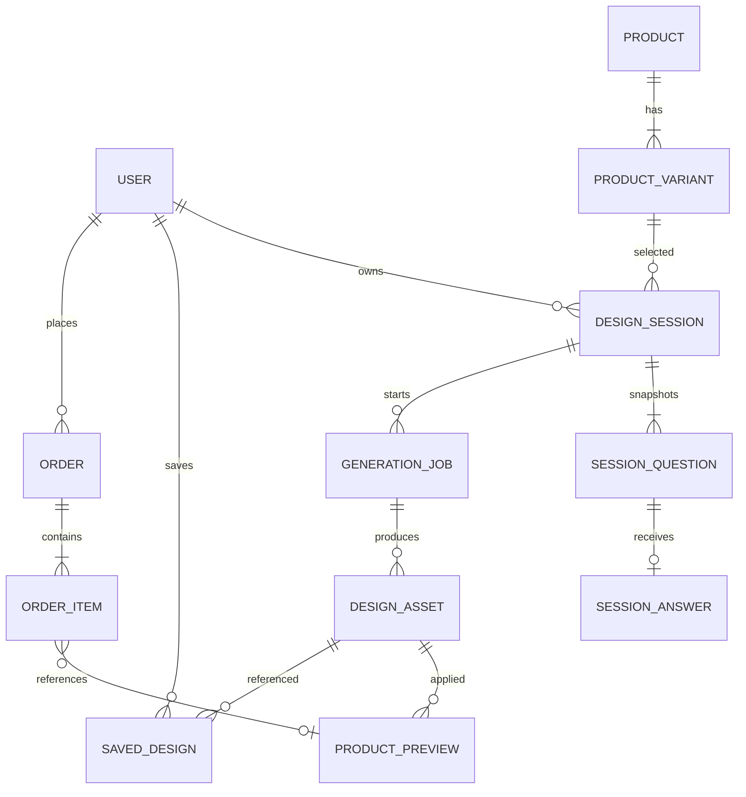
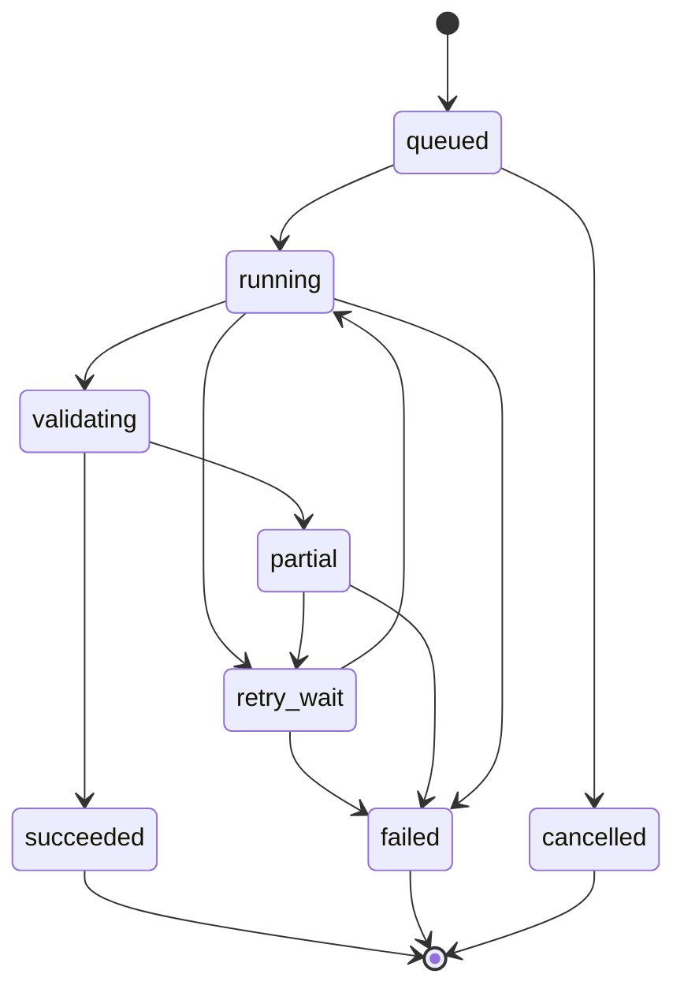

# Xinobi E-Ticaret Sitesi ve Mobil Uygulaması
## Detaylı Kavramsal ve Teknik Analiz

**Tarih:** 1 Ekim 2026  
**Sürüm:** 1.0  
**Durum:** Gereksinim analizi ve önerilen çözüm tasarımı  
**Kaynak:** Kullanıcının sağladığı iki sayfalık `detaylar.pdf`  
**Kapsam:** Web mağazası, mobil uygulama, yönetim paneli, XINOBI U kişiselleştirme ve Nobi satış asistanı.

> Bu belge, PDF’deki talepleri uygulanabilir iş kurallarına ve teknik gereksinimlere dönüştürür. Mevcut kaynak kod, veri tabanı, AI API sözleşmesi, üretim yöntemi ve altyapı incelenmemiştir. Buradaki mimari ve teknoloji seçimleri öneridir; mevcut sistemin doğrulanmış özellikleri değildir. PDF’deki tekrarlanan soru havuzu satırları tek gereksinim olarak ele alınmıştır.

## İçindekiler

1. Belgenin okunması ve kaynak ayrımı
2. Proje vizyonu ve kavramsal model
3. Paydaşlar ve yetkiler
4. Kapsam ve gereksinim envanteri
5. Bilgi mimarisi ve ekranlar
6. Kullanıcı yolculukları
7. XINOBI U iş kuralları
8. Nobi kavramsal analizi
9. E-ticaret ve operasyon süreçleri
10. Yönetim paneli
11. Mobil uygulama analizi
12. Teknik mimari ve teknoloji kararları
13. Veri modeli
14. API sözleşmeleri
15. Soru havuzu ve güvenli AI eşleme
16. Görsel üretimi ve ürün üzerine uygulama
17. Sipariş ve ödeme tutarlılığı
18. Medya ve içerik altyapısı
19. Güvenlik ve veri yaşam döngüsü
20. Kalite hedefleri ve gözlemlenebilirlik
21. Test ve kabul planı
22. Teslimat planı
23. Riskler ve açık kararlar
24. Gereksinim izlenebilirliği ve tamamlanma ölçütleri

---

## 1. Belgenin Okunması ve Kaynak Ayrımı

### 1.1 Gereksinim türleri

| Etiket | Anlamı | Uygulamadaki karşılığı |
|---|---|---|
| K | PDF’de açıkça istenen özellik | Kaynak gereksinim; teslimat kapsamına alınmalı |
| T | Kullanıcının bu isteğinde belirtilen kapsam | E-ticaret sitesi ve mobil uygulama |
| Ö | Bu analizde önerilen çözüm veya tamamlayıcı gereksinim | Ürün sahibi tarafından değerlendirilmesi gereken tasarım |
| A | Açık karar veya varsayım | Doğrulanmadan kesin iş kuralı kabul edilmemeli |

PDF ağırlıklı olarak ana sayfa, kişiselleştirme ve Nobi deneyimini tarif eder. Ödeme, kargo, iadeler, mobil ekranlar ve satıcı yönetimi ayrıntıları kaynakta yoktur. Bunlar e-ticaret projesini tamamlamak için öneri olarak tanımlanmıştır.

### 1.2 Terminoloji

| Terim | Tanım |
|---|---|
| Xinobi | Web ve mobil kanallardan erişilen e-ticaret markası/platformu |
| XINOBI U | Kişiselleştirilebilir ürünlerin keşfedildiği ve tasarlandığı deneyim |
| Nobi | Katalog ve onaylı bilgiler üzerinden yardımcı olan AI satış asistanı |
| Tasarım | AI ile üretilen veya kullanıcı tarafından yüklenen özgün desen/görsel |
| Önizleme | Tasarımın ürün üzerindeki temsili gösterimi |
| Üretim dosyası | Üretim sürecinde kullanılabilir ölçü, çözünürlük ve renk özelliklerine sahip çıktı |
| Tasarım oturumu | Ürün, soru seti, cevaplar ve üretim işlerini bir araya getiren süreç |
| Soru ekseni | Doğa, ruh hâli, renk, görsel veya tarz tercih boyutu |
| SKU | Satılabilir ürün varyantının benzersiz stok kodu |

Önizleme, tasarım ve üretim dosyası farklı varlıklardır. Bir önizlemenin başarılı oluşturulması, fiziksel üretime uygun dosyanın hazır olduğu anlamına gelmez.

## 2. Proje Vizyonu ve Kavramsal Model

### 2.1 Vizyon

Xinobi, standart ev ve küçük ev aletleri alışverişini, kullanıcının tercihlerini tasarıma dönüştüren XINOBI U deneyimiyle birleştirir. Nobi, ürün keşfinde ve kişiselleştirme sürecinde kullanıcıya yardımcı olur. Web ve mobil uygulama aynı katalog, hesap, tasarım ve sipariş kayıtlarını paylaşır.

Temel değer önerisi: **Kullanıcı istediği ürünü bulur, kendi zevkine uygun görseli oluşturur veya yükler, üründeki görünümünü inceler ve uygunluk koşulları sağlandığında satın alır.** Satın alınabilir kişiselleştirme bu analizde önerilen tamamlayıcı kapsamdır; PDF doğrudan satın alma adımlarını tarif etmez.

### 2.2 İş hedefleri

| Hedef | Ölçüm | Yorum |
|---|---|---|
| Ürün keşfini kolaylaştırmak | Listeleme → ürün detayı dönüşümü | Kanal, kategori ve cihaz bazında izlenmeli |
| Kişiselleştirme katılımını artırmak | XINOBI U oturum başlatma ve tamamlama oranı | Tamamlama: kullanılabilir dört adayın sunulması |
| Tasarımın alışverişe katkısını görmek | Tasarım seçimi → sepet → ödeme dönüşümü | AI kullanımı tek başına satış başarısı sayılmaz |
| İçerik operasyonunu hızlandırmak | Banner taslağı → yayın süresi | Admin paneli üzerinden ölçülür |
| Nobi’nin yardım kalitesini ölçmek | Yararlı yanıt oranı ve yanlış bilgi oranı | Kullanıcı geri bildirimi ve örneklem denetimi |
| AI maliyetini kontrol etmek | Başarılı oturum ve sipariş başına üretim maliyeti | Yeniden denemeler de maliyete dahil edilir |

Başlangıç trafik, satış ve bütçe verisi bulunmadığı için iş hedeflerine sayısal başarı oranı atanmaz. İlk ölçümlerden sonra hedefler belirlenmelidir.

### 2.3 Kavramsal ilişki



### 2.4 Kapsam sınırları

İlk sürüm önerisi: tek mağaza işletmesi, tek ortak backend, web ve mobil müşteri deneyimi, web tabanlı yönetim paneli. Çok satıcılı pazaryeri, satıcı hakedişi, uluslararası vergi motoru, AR ve gerçek 3D görüntüleme otomatik olarak bu kapsama dahil değildir.

“Market hesabı açılacak” ifadesi, çok satıcılı pazaryeri anlamına geldiği doğrulanmadan satıcı mimarisine dönüştürülmemelidir. Bu ifade müşteri hesabı, dış pazaryeri hesabı veya mobil mağaza geliştirici hesabı da olabilir.

## 3. Paydaşlar ve Yetkiler

| Rol | İşlev | Erişim sınırı |
|---|---|---|
| Ziyaretçi | Katalog, banner, Nobi ve önerilen misafir tasarım akışı | Hesap geçmişi ve başka kullanıcı verilerine erişemez |
| Üye müşteri | Tasarım kaydı, adresler, siparişler | Yalnızca kendi kaynakları |
| İçerik yöneticisi | Slider, keşfet alanı, metin ve medya | Ödeme ve hesap yetkisi yok |
| Katalog yöneticisi | Kategori, ürün, varyant, kişiselleştirme uygunluğu | Tahsilat/iade onayı yok |
| AI içerik sorumlusu | Soru havuzu, şık ifadeleri, eşleme incelemesi | Üretim sağlayıcısı anahtarlarını göremez |
| Operasyon sorumlusu | Sipariş ve üretim dosyası yönetimi | Gerekli müşteri verisiyle sınırlı |
| Destek personeli | Yetkili sipariş görünümü ve destek | Veri dışa aktarma ve finans işlemleri sınırlı |
| Sistem yöneticisi | Rol, entegrasyon ve sistem ayarı | Güçlü kimlik doğrulama ve denetim kaydı |
| Harici servis | Ödeme, kargo, AI, mesaj gönderimi | Yalnızca sözleşmedeki gerekli veri |

Roller öneridir. Küçük ekipte aynı kişi birden fazla rol alabilir; yetkiler yine ayrı tanımlanmalıdır. Üretim dosyası onayı ile müşteri desteği erişimi aynı yetki olmamalıdır.

## 4. Kapsam ve Gereksinim Envanteri

| ID | Tür / kaynak | Gereksinim | Öncelik |
|---|---|---|---|
| K-01 | K / s.1 | Header altında ekranı kaplayan ana slider | Zorunlu |
| K-02 | K / s.1 | Adminin fotoğraf, video ve karma slider içeriği eklemesi | Zorunlu |
| K-03 | K / s.1 | Marka alanlarında “Kişiselleştirilmiş ürünler” yerine “XINOBI U” | Zorunlu |
| K-04 | K / s.1 | XINOBI U bannerının ana sliderın hemen altında olması | Zorunlu |
| K-05 | K / s.1 | Ardından kategori kolonları | Zorunlu |
| K-06 | K / s.1 | Ardından öne çıkan ürün sliderı | Zorunlu |
| K-07 | K / s.1 | Ardından keşfet bannerları; görsel, yazı ve keşfet butonu admin yönetimi | Zorunlu |
| K-08 | K / s.1 | Sağ altta sabit Nobi sembolü ve “Nobi’ye sor” alanı | Zorunlu |
| K-09 | K / s.1 | Nobi sohbeti ve “Size nasıl yardımcı olabilirim?” karşılaması | Zorunlu |
| K-10 | K / s.1 | Sayfalarda aynı font ve uyumlu tasarım | Zorunlu |
| K-11 | K / s.1 | Açılır kategori menüsünde kaynakta belirtilen yedi sekme | Zorunlu |
| K-12 | K / s.1 | XINOBI U kişiselleştirilmiş görsellerinde “Temsilidir” ibaresi | Zorunlu |
| K-13 | K / s.1 | Market hesabı açılması | Anlamı netleşmeli |
| K-14 | K / s.1 | “İstediğiniz görseli ekleyebilirsiniz” yükleme alanı | Zorunlu |
| K-15 | K / s.1–2 | AI destekli geniş havuz; beş eksen, rastgele beş soru, her soruda tam dört şık | Zorunlu |
| K-16 | K / s.1–2 | Her oturumda soru ve şık sıralarının değişmesi; aynı soru için alternatif şık ifadeleri | Zorunlu |
| K-17 | K / s.2 | Cevapların mevcut AI görsel sistemine güvenli eşlenmesi | Zorunlu |
| K-18 | K / s.2 | XINOBI U sekmesinde tüm kişiselleştirilebilir ürünlerin listelenmesi | Zorunlu |
| K-19 | K / s.2 | Önce ürün seçimi, sonra sorular, ardından dört AI tasarımı | Zorunlu |
| K-20 | K / s.2 | Seçilen tasarımın seçilen ürün üzerinde gösterilmesi | Zorunlu |
| K-21 | K / s.2 | Üretilen tasarımların kaydedilebilmesi | Zorunlu |
| T-01 | T / kullanıcı isteği | Web e-ticaret sitesi ve mobil uygulama | Zorunlu |
| Ö-01 | Ö | Hesap, sepet, ödeme, sipariş ve teslimat süreçleri | E-ticaret için önerilen çekirdek |
| Ö-02 | Ö | Tasarımın siparişe değişmez kayıt olarak bağlanması | Kişiselleştirilmiş satış için gerekli |
| Ö-03 | Ö | İçerik taslak/onay/yayın ve denetim kaydı | Operasyon için önerilen |
| Ö-04 | Ö | AI maliyet sınırları, asenkron iş takibi ve güvenli dosya yükleme | Üretim güvenilirliği için gerekli |

“Dilediği kadar slider” gereksinimi yönetim tarafında yapay düşük bir adet sınırı bulunmaması olarak yorumlanmıştır. Tüm videoların aynı anda indirilmesi anlamına gelmez. Depolama kotası ve dosya boyutu sınırları teknik kapasite kararlarıdır.

## 5. Bilgi Mimarisi ve Ekranlar

### 5.1 Ana sayfanın kesin sıralaması

1. Header ve genişletilebilir kategoriler menüsü.
2. Görsel/video içeren ana slider.
3. Öne çıkarılmış XINOBI U bannerı.
4. Kategori kolonları.
5. Öne çıkan ürün sliderı.
6. Keşfet bannerları ve ilgili ürünlere yönlendiren butonlar.
7. Önerilen footer: destek, iletişim ve ilgili bilgi sayfaları.

Nobi erişim düğmesi web ekranının sağ altında sabit bulunur. Mobilde alt navigasyon ve cihazın güvenli alanlarıyla çakışmayacak konumda gösterilir.

### 5.2 Kategori menüsü

Kaynakta belirtilen etiketler aynen korunur: **Çay Makineleri, Kahve Makineleri, Tost Makineleri, Pişirme Makineleri, Hava Temizleme, Desenler, XINOBI U.**

İlk beş öğe ürün kategorisi olarak modellenebilir. Desenler bir desen koleksiyonu sayfasına, XINOBI U kişiselleştirme kataloğuna gider. Menü aynı görsel düzeni paylaşsa da bu iki öğeyi zorunlu olarak ürün kategorisi tablosuna eklemek gerekmez. Desenler alanındaki lisans, seçme ve satın alma davranışı açık karardır.

### 5.3 Ekran envanteri

| Alan | Temel ekranlar | Kritik durumlar |
|---|---|---|
| Keşif | Ana sayfa, kategori, arama, ürün detayı | Boş sonuç, stok dışı, medya yüklenememesi |
| XINOBI U | Uygun ürünler, ürün seçimi, soru akışı, yükleme, üretim, dört aday, önizleme | Eksik cevap, uygunsuz dosya, kısmi üretim, iş süresi aşımı |
| Tasarımlar | Tasarım listesi ve detay | Silinmiş ürün, artık uygun olmayan varyant |
| Alışveriş | Sepet, adres, teslimat, ödeme, sonuç | Fiyat değişikliği, stok çakışması, belirsiz ödeme |
| Hesap | Giriş, kayıt, profil, adresler, siparişler | Oturum sona ermesi, hesap kurtarma |
| Nobi | Karşılama, sohbet, ürün kartları, destek aktarımı | Bilgi bulunamaması, servis kesintisi |
| Admin | İçerik, katalog, sorular, eşlemeler, tasarımlar, siparişler | Yetki reddi, yayın doğrulama hatası |

### 5.4 Görsel tutarlılık ve erişilebilirlik

Tek ana font ailesi, ortak renk ve boşluk tokenları, standart butonlar ve aynı ürün kartı dili kullanılır. Web ve mobilde teknik font dosyaları farklı biçimde dağıtılsa da marka tipografisi aynı kalır. Font lisansı ve Türkçe karakter desteği doğrulanır.

Slider klavye ile kullanılabilir, odak durumu görünür olur ve hareketi durdurma kontrolü bulunur. Metinler görsellerin içine zorunlu gömülmez. Video için poster ve gerektiğinde altyazı sağlanır. Dokunma hedefleri ve kontrastlar erişilebilirlik testinden geçirilir. “Temsilidir” etiketi okunabilir metindir; yalnızca hover ile gösterilmez.

## 6. Kullanıcı Yolculukları

### 6.1 Standart alışveriş — önerilen

Kullanıcı kategori veya aramadan ürüne ulaşır; varyant, stok ve fiyatı görür; sepete ekler; adres ve teslimatı seçer; sunucunun güncel hesapladığı tutarla ödeme başlatır. Sipariş sonucu ödeme sağlayıcısının doğrulanmış sonucuyla gösterilir. E-posta/bildirim gönderim hatası siparişi geri almaz.

### 6.2 AI ile kişiselleştirme — kaynağa dayalı

1. Kullanıcı XINOBI U listesinden kişiselleştirilebilir ürünü seçer.
2. Önerilen varyant seçimiyle ürünün kişiselleştirme şablonu belirlenir.
3. Sunucu beş soruluk oturum oluşturur.
4. Kullanıcı her soruda dört şıktan birini seçer.
5. Sistem cevapları doğrular ve güvenli tasarım profiline dönüştürür.
6. AI üretim işi oluşturulur; kullanıcı ilerleme ekranını görür.
7. Dört kullanılabilir tasarım gösterilir.
8. Kullanıcı bir tasarımı seçer; ürün üzerinde temsili önizleme oluşur.
9. Tasarım kaydedilebilir. Önerilen satın alma akışı, üretim uygunluğu ve fiyat kontrolünden sonra devam eder.

### 6.3 Kendi görselini yükleme — kaynak + öneri

Kullanıcı aynı ürün akışındaki yükleme alanından dosya seçer. Dosya kontrol edilir, güvenli kopyası oluşturulur, uygun yüzeye uygulanır ve temsili önizleme gösterilir. Yükleme yolunun beş soruya alternatif olması öneridir; kaynak, soruların yükleme için de zorunlu olup olmadığını belirtmez. Bu belgedeki varsayılan: **AI üretimi ve kendi görselini yükleme iki ayrı giriş yolu; ortak önizleme ve kayıt adımları.**

### 6.4 Kaydedilen tasarıma dönüş

Üye kendi tasarımlarını web veya mobilde açar. Tasarımın özgün dosyası korunur. Güncel üründe tekrar kullanım, şablon sürümü, stok ve kişiselleştirme uygunluğu kontrolünden geçer. Önceki siparişin önizlemesi yeni şablonla sessizce değiştirilmez.

### 6.5 İçerik yayını

İçerik yöneticisi slider veya keşfet bannerını taslak oluşturur; medya ve bağlantı doğrulanır; masaüstü/mobil önizleme yapılır; yetkili kullanıcı yayınlar. Yayın atomik olarak yeni içerik sürümünü açar. Hatalı yayında önceki sürüme dönülebilir.

## 7. XINOBI U İş Kuralları

| ID | İş kuralı | Dayanak |
|---|---|---|
| BR-01 | XINOBI U listesinde kişiselleştirmeye açık ürünler bulunur | K-18 |
| BR-02 | Ürün seçilmeden soru oturumu başlatılmaz | K-19 |
| BR-03 | AI yolunda oturum tam beş soru içerir | K-15 |
| BR-04 | Her soruda tam dört seçenek bulunur | K-15 |
| BR-05 | Yeni oturumda soru ve seçenek sıraları yeniden oluşturulur | K-16 |
| BR-06 | Alternatif şık ifadesi aynı kavramsal anlamı korur | K-16–17 için teknik yorum |
| BR-07 | Beş cevap tamamlanmadan AI üretimi başlatılmaz | Önerilen doğrulama |
| BR-08 | Başarılı AI oturumunda dört kullanılabilir aday sunulur | K-19 |
| BR-09 | Seçilen aday, seçilen ürünün önizlemesinde kullanılır | K-20 |
| BR-10 | Kişiselleştirilmiş ürün önizlemesinde “Temsilidir” görünür | K-12 |
| BR-11 | Üretilen tasarımlar saklanabilir | K-21 |
| BR-12 | İstemci fiyat, stok ve baskı uygunluğu konusunda otorite değildir | Önerilen ticaret kuralı |
| BR-13 | Başka müşterinin tasarımına doğrudan ID ile erişilemez | Önerilen güvenlik kuralı |

### 7.1 Beş eksenin yorumu

PDF beş ekseni ve toplam beş soruyu belirtir; her eksenden bir soru şartını açıkça söylemez. Önerilen kural: **doğa, ruh hâli, renk, görsel ve tarz eksenlerinin her birinden bir soru**. Bu, eksik tercih boyutu bırakmadan beş soruluk kısa deneyim sağlar. Ürün sahibinin farklı dağılım istemesi durumunda seçim stratejisi değiştirilir.

“Tasarım yoğunluğu” ifadesinin ayrı bir altıncı eksen olduğu varsayılmamıştır. Yoğunluk, örneğin tarz veya görsel eksenindeki cevaplardan türetilebilir; ürün sahibiyle doğrulanmalıdır.

### 7.2 Rastgelelik ve anlam tutarlılığı

Rastgele seçim aynı oturum içinde sabitlenir. Sayfa yenilemek yeni soru seti üretmez. Yeni oturum yeni örneklem oluşturur. Tam rastgelelik bir önceki sıranın yeniden çıkmasına izin verir; kaynakta “değişiyor” denildiği için önerilen uygulama, önceki soru ve seçenek dizilimiyle birebir aynı sonucu mümkün olduğunda reddeder.

Anonim kullanıcıda geçmiş bilinmiyorsa önceki oturuma göre değişim garanti edilemez. Anonim oturum tanımlayıcısı ve izin verilen kısa geçmiş ile bu durum yönetilir. Aynı soru tekrar gelebilir; kaynak bunu açıkça kabul eder. Tüm soruların her seferinde farklı olması vaat edilmez.

### 7.3 Kayıt ve sahiplik

Önerilen misafir üretimi kısa süreli oturumla çalışır; kalıcı kayıt için hesap gerekir. Giriş sırasında misafir oturumu yalnızca sahiplik kanıtıyla hesaba bağlanır. Kayıt; tasarım dosyası, cevap profili, seçilen ürün, önizleme ve kullanılan sürümleri korur. Kullanıcının “cihaza indir” isteği ile “hesabımda sakla” işlevi farklıdır; PDF’nin kayıt ifadesi için varsayılan hesapta saklamadır.

## 8. Nobi Kavramsal Analizi

### 8.1 Amaç ve davranış

Nobi, “Size nasıl yardımcı olabilirim?” karşılamasıyla açılır. Ürün bulma, kategori yönlendirmesi, ürün karşılaştırma ve XINOBI U adımlarını açıklama önerilen yeteneklerdir. Yanıtlar kısa, anlaşılır ve ürün bağlantılarıyla destekli olmalıdır.

| Soru türü | Bilgi kaynağı | Güvenli sonuç |
|---|---|---|
| Ürün özellikleri | Onaylı katalog alanları | Doğrulanmış özellik ve ürün linki |
| Fiyat / stok | Anlık ticaret API’si | Güncel kontrol sonucu; yoksa tahmin üretmemesi |
| Kişiselleştirme | Ürün yetenekleri ve onaylı rehber | Uygun ürün/akış yönlendirmesi |
| Teslimat / iade | Onaylı güncel mağaza politika içeriği | Politika linki ve gerektiğinde destek |
| Siparişim nerede? | Kimliği doğrulanmış sipariş servisi | Yalnızca kullanıcının kendi siparişi |
| Bilinmeyen soru | Kaynak bulunamaması | Bilmediğini belirtme ve destek seçeneği |

PDF sipariş sorgulaması veya sepet işlemi yetkisi istemez. İlk sürümde Nobi salt okuma ve yönlendirme yapmalıdır. Sepete ekleme ileride açılırsa ürün/varyant/adet açıkça gösterilir ve kullanıcı işlemi doğrular. Nobi ödeme, iptal veya iade işlemini kendiliğinden gerçekleştirmez.

### 8.2 Tasarım asistanıyla ilişki

Nobi kullanıcıyı XINOBI U’ya yönlendirebilir; ancak sohbet cevabı beş soruluk oturumun yerine geçmez. Tasarım profili yapılandırılmış cevaplardan üretilir. Sohbetten türetilen önerilerin otomatik olarak cevap sayılması ayrı onaylanacak özellik olur.

### 8.3 Bilgi güncelliği

Onaylı bilgi metinleri sürümlenir. Arama indeksindeki eski fiyat ve stok alanları karar kaynağı olarak kullanılmaz. Ürün kartları gösterilmeden aktiflik ve erişilebilirlik kontrolü yapılır. Destek aktarımında kullanıcıya konuşmanın paylaşılacağı açıklanır.

## 9. E-Ticaret ve Operasyon Süreçleri

Bu bölüm PDF dışında, e-ticaret kapsamını tamamlamak üzere önerilmiştir.

### 9.1 Katalog ve stok

Ürün, varyant ve kişiselleştirme kabiliyeti ayrı tutulur. Bir ürünün bazı varyantları kişiselleştirilebilirken diğerleri olmayabilir. Stok varyant veya depo seviyesinde yönetilir. Ön sipariş/üretim üzerine satış desteklenecekse normal hazır stoktan ayrı durum ve teslim süresi kullanılır.

### 9.2 Fiyatlandırma

Sunucu toplamı ürün fiyatı, kişiselleştirme bedeli, kampanya, vergi ve kargo kalemleriyle hesaplar. Para değeri kayan noktalı sayı yerine en küçük para birimi cinsinden tamsayı ve para birimi koduyla saklanır. AI üretim bedelinin müşteriye ücretlendirilip ücretlendirilmeyeceği açık karardır; ilk sürüm için kota kontrollü kullanım önerilir.

### 9.3 Kişiselleştirilmiş üretim

Satışa açılmadan önce ürün yüzeyi, uygulanabilir teknik, baskı ölçüsü, çözünürlük, renk profili ve fiziksel ürünün güvenlik/garanti etkisi operasyon tarafından belirlenir. Görsel olarak kaplanabilen her bölge üretim için uygun kabul edilmez.

Önerilen akış: uygun dosya → müşteri önizleme onayı → ödeme → üretim dosyası teknik kontrolü → üretim → kalite kontrol → sevkiyat. Teknik kontrolde dosya uygun değilse düzeltme veya müşteriyle çözüm süreci açılır; sipariş sessizce başka tasarıma çevrilmez.

### 9.4 İade ve destek

İade koşulları standart ve kişiselleştirilmiş ürün için ayrı yapılandırılabilir. Bu belge hukuki iade süresi veya istisna hükmü belirlemez. Yayına alınacak politika metinleri işletme tarafından güncel mevzuat ve satış modeli açısından doğrulanmalıdır. Teknik olarak sipariş satırı, talep, karar, geri ödeme ve stok etkisi ayrı izlenir.

## 10. Yönetim Paneli

| Modül | Yönetilecek alanlar | Yayın öncesi kontrol |
|---|---|---|
| Ana slider | Medya türü, dosya, poster, metin, link, sıra, aktiflik, yayın zamanı | Medya hazır; link geçerli; mobil görünüm uygun |
| XINOBI U bannerı | Görsel, başlık, açıklama, yönlendirme | Ana sayfa konumu sabit; marka etiketi doğru |
| Kategoriler | İsim, görsel, sıra, görünürlük | Link ve aktif kategori eşleşmesi |
| Öne çıkan ürünler | Ürün listesi ve sırası | Yayınlanmış ve satışa uygun ürün |
| Keşfet bannerları | Görsel, başlık, metin, buton etiketi ve hedefi | Boş veya tehlikeli bağlantı bulunmaması |
| Katalog | Ürün, varyant, fiyat, stok, özellik | SKU bütünlüğü ve fiyat doğrulama |
| Kişiselleştirme | Uygunluk, şablon, maske, teknik sınırlar | Onaylı örnek önizleme |
| Soru havuzu | Eksen, soru, dört anlam, alternatif ifadeler | Semantik eşleme ve dört şık şartı |
| Nobi bilgisi | Onaylı rehberler ve mağaza politikaları | İçerik sahibi ve güncellik kaydı |
| AI operasyonu | İşler, hatalar, kotalar, maliyet özetleri | Ham kullanıcı verisine kısıtlı erişim |
| Sipariş | Üretim, sevk ve destek durumu | Rol ve durum geçişi kontrolü |

Soru ve cevap AI ile taslak üretilebilir; doğrudan canlıya yayınlanmaz. İnceleyen kişi anlamı, tekrarları, ürünle ilişkisini ve eşleme doğruluğunu kontrol eder. İçerik silmek yerine kullanımda olan sürümler arşivlenir; geçmiş oturumların açıklanabilirliği korunur.

## 11. Mobil Uygulama Analizi

### 11.1 Ortak ürün kapsamı

Web ile aynı katalog, fiyat, kullanıcı hesabı, tasarım kütüphanesi ve sipariş servisleri kullanılır. Önerilen alt navigasyon: Ana Sayfa, Kategoriler, XINOBI U, Sepet, Hesabım. Nobi sabit erişimi alışveriş butonlarını kapatmaz.

Mobil soru akışında bir soru/ekran, adım göstergesi ve önceki adıma dönme bulunur. Uygulama arka plana geçtiğinde AI işi sunucuda devam eder; geri dönüldüğünde iş durumu alınır. Bildirim izni verilmemesi akışı engellemez.

### 11.2 Cihaz yetenekleri

Galeri/kamera izni yalnızca görsel seçme sırasında istenir. İzin reddinde dosya seçme veya AI yoluna dönüş sunulur. Hassas oturum bilgileri işletim sisteminin güvenli depolamasında saklanır. Push bildirimleri önerilen sipariş/üretim tamamlanma işlevleridir; PDF gereksinimi değildir.

### 11.3 Bağlantı kaybı

Katalog ve tasarım küçük görselleri kontrollü önbelleğe alınabilir. Çevrimdışıyken ödeme veya yeni AI üretimi başlatılmaz. Cevaplar geçici saklanabilir; bağlantı geldiğinde oturum sürümü doğrulanır. Ekranın “başarılı” görünmesi yerine sunucu sonucu beklenir.

### 11.4 Mağaza yayını

iOS ve Android hedeflenmesi öneridir; kullanıcı hedef platformları doğrulamalıdır. Geliştirici hesapları, uygulama adı, görseller, gizlilik beyanları, test dağıtımı ve sürüm imzalama teslimat planına girer. “Market hesabı” ifadesinin bu hesaplara işaret ettiği varsayılmaz.

## 12. Teknik Mimari ve Teknoloji Kararları

### 12.1 Önerilen mimari

Başlangıç için **modüler monolit ticaret backend’i + ayrı asenkron AI/medya işçileri** önerilir. Sipariş, fiyat ve stok işlemlerini ortak işlem sınırında tutar; pahalı görsel işleri kullanıcı isteklerini bloke etmez. Ölçek ve ekip verisi olmadan mikroservis sayısı artırılmaz.



### 12.2 Teknoloji adayları

| Katman | Önerilen aday | Karar gerekçesi / alternatif |
|---|---|---|
| Web | React + Next.js + TypeScript | SEO, sayfa üretimi, ortak bileşenler; mevcut proje uygunsa onu koruma önceliği |
| Mobil | React Native + TypeScript | Paylaşılan tip ve iş mantığı; ekip Flutter biliyorsa Flutter değerlendirilebilir |
| Admin | React tabanlı web uygulaması | Ortak tasarım sistemi, ayrı rol kontrolü |
| Backend | Node.js + TypeScript; NestJS veya mevcut framework | Modül sınırları ve doğrulama; mevcut backend görülmeden yeniden yazım önerilmez |
| Veri tabanı | PostgreSQL | İlişkiler, işlemler, sipariş/stok tutarlılığı |
| Kuyruk / önbellek | Redis tabanlı çözüm veya yönetilen kuyruk | Asenkron iş, kısa süreli oturum ve hız sınırı; kalıcı iş kaydı DB’de |
| Medya | Nesne depolama + CDN | Orijinaller, özel tasarımlar, optimize kamusal katalog görselleri |
| AI | Mevcut sağlayıcı için adaptör | Kaynaktaki mevcut sisteme kontrollü entegrasyon |
| Arama | İlk aşamada DB araması; gerekirse özel indeks | Trafik ve arama kalitesiyle karar verme |
| Dağıtım | Konteyner veya yönetilen uygulama ortamı | Ekip ve maliyet verisine göre seçim |

Bunlar sürüm, fiyat veya sağlayıcı üstünlüğü iddiası değildir. Kesin paket sürümleri ve sağlayıcı limitleri uygulama sırasında resmi belgelerden doğrulanmalı, lockfile ve karar kaydıyla sabitlenmelidir.

### 12.3 Backend modülleri

`identity`, `catalog`, `content`, `personalization`, `question-bank`, `ai-jobs`, `nobi`, `cart`, `checkout`, `orders`, `fulfillment`, `notifications`, `audit`.

Modüller başka modülün tablolarını rastgele değiştirmez; servis arayüzü kullanır. Kritik DB değişikliğiyle yayınlanacak olay aynı işlemde outbox tablosuna yazılır. Ayrı işçi olayları kuyruğa taşır; tüketiciler aynı olay tekrar gelirse güvenle işleyebilmelidir.

### 12.4 Mevcut sistem keşfi

Uygulamaya başlamadan repository yapısı, backend endpointleri, mevcut AI üretim girdi/çıktıları, veri tabanı şeması, kimlik doğrulama, medya depolama, mevcut maske/segmentasyon sistemi ve ödeme bağlantısı incelenir. Bu belge mevcut AI sisteminin doğrudan ürün kaplama ürettiğini varsaymaz. Adaptörün kapsamı keşif sonucunda kesinleşir.

## 13. Veri Modeli

### 13.1 Çekirdek varlıklar

| Varlık | Önemli alanlar | Bütünlük kuralı |
|---|---|---|
| User | id, email, status, created_at | E-posta normalizasyonu ve benzersizlik |
| Role / UserRole | role, permissions, user_id | Yetki sunucuda değerlendirilir |
| Category | id, slug, parent_id, status, sort_order | Menü yönlendirmesinden bağımsız kategori ağacı |
| NavigationItem | label, kind, target, sort_order | Kategori veya özel sayfa hedefi |
| Product | id, slug, title, category_id, status | Yayınlı ürün ve uygun varyant ayrımı |
| ProductVariant | id, product_id, sku, price_minor, currency | Benzersiz SKU |
| Inventory | variant_id, on_hand, reserved, version | Satılabilir stok eksiye düşmez |
| PersonalizationCapability | variant_id, template_version_id, enabled | Onaysız şablonla satış açılmaz |
| ProductTemplateVersion | view_asset_id, mask_asset_id, mapping, print_spec | Sürüm kullanıldıktan sonra değişmez |
| MediaAsset | id, storage_key, owner_id, kind, status, checksum | Dosya denetlenmeden erişime açılmaz |
| ContentBlockVersion | type, placement, payload, publish_at, status | Yayın yalnızca hazır medyaya referans verir |
| QuestionVersion | question_id, axis, text, status | Yayınlanmış sürümde tam dört semantik seçenek |
| OptionMeaning | id, question_version_id, mapping_code | Görünen sıra anlamı belirlemez |
| OptionWording | meaning_id, text, locale, version | Aynı anlam için alternatif ifadeler |
| DesignSession | id, owner/guest_id, variant_id, status, expires_at | Kullanıcı/oturum sahipliği |
| SessionQuestion | session_id, question_version_id, position, shown_options | Gösterilen ifadelerin değişmez kopyası |
| SessionAnswer | session_question_id, option_meaning_id | Yalnızca oturumda sunulan seçenek kabul edilir |
| GenerationJob | session_id, status, provider_ref, attempt, cost, idempotency_key | Tekrarlı istekte yeni ücretli iş açılmaz |
| DesignAsset | job_id, slot, asset_id, moderation_status | İş içinde 1–4 aday yuvası benzersiz |
| SavedDesign | user_id, design_asset_id, preview_id | Sahiplik denetimi |
| ProductPreview | design_id, template_version_id, asset_id, status | Tasarım ve şablon sürümü birlikte kayıt |
| Cart / CartItem | owner, variant_id, quantity, personalization_id | Kişiselleştirme sahibi sepet sahibiyle eşleşir |
| Order / OrderItem | totals, status, product_snapshot, personalization_snapshot | Sipariş anındaki kayıt değişmez |
| PaymentAttempt | order_id, provider_ref, status, amount, currency | Sağlayıcı referansı benzersiz |
| Shipment / Return | order_id, tracking, status, line_refs | Siparişten ayrı yaşam döngüsü |
| Conversation / Message | owner, role, text, tool_refs | Nobi konuşması erişim kontrolü |
| AuditEvent / OutboxEvent | actor, action, resource, timestamp | Hassas ham veri loga yazılmaz |

### 13.2 Temel ilişkiler



Başarılı oturumda beş soru ve dört kullanılabilir aday zorunluluğu servis doğrulaması ve uygun DB kısıtlarıyla korunur. ER diyagramındaki genel çokluklar bu sabit adet kurallarının yerini almaz.

### 13.3 İndeks ve saklama

Ürün `slug`, varyant `sku`, ödeme referansı, webhook olay kimliği ve idempotency kapsamı benzersiz indeks alır. Kullanıcıya ait tasarım/sipariş sorguları `(user_id, created_at)` ile indekslenir. Ürün filtreleri gerçek sorgu planına göre optimize edilir. Büyük görseller DB’ye base64 olarak konmaz; DB dosya kimliği ve metadata tutar.

## 14. API Sözleşmeleri

Örnek yollar önerilen `/api/v1` sözleşmesidir. Sayfalama, hata yapısı ve sürümleme web/mobil/admin için ortak olur. Admin endpointleri ayrı yetki politikasıyla korunur.

| Yöntem ve yol | İşlev | Kritik kontrol |
|---|---|---|
| GET /content/home | Yayındaki ana sayfa içeriği | Kanal, locale, yayın zamanı |
| GET /navigation | Kategori ve özel sayfa menüsü | Aktif hedefler |
| GET /products | Filtreli ürün listesi | Sayfalama ve izin verilen filtreler |
| GET /products/{id} | Ürün/varyant detayı | Aktiflik ve güncel ticaret alanları |
| GET /personalizable-products | XINOBI U listesi | Uygun ürünlerin tamamına sayfalı erişim |
| POST /design-sessions | Ürün ve yol için oturum | Uygun varyant; sahiplik; kota |
| GET /design-sessions/{id} | Sabit soru seti/durum | Sahiplik |
| PUT /design-sessions/{id}/answers | Beş cevabı kaydetme | Oturum soru ve seçenek kimlikleri |
| POST /design-sessions/{id}/generations | Dört aday üretim işini başlatma | Tam cevap; idempotency; sunucu kota |
| GET /generation-jobs/{id} | İş durumu | Sahiplik; maliyet gibi iç alanlar gizli |
| POST /uploads/intents | Güvenli yükleme izni | Tür, boyut, kullanıcı ve ürün bağlamı |
| POST /uploads/{id}/complete | Yüklemeyi doğrulama | Boyut/checksum; dosya taraması |
| POST /product-previews | Tasarımın ürüne uygulanması | Tasarım ve şablon yetkisi |
| POST /saved-designs | Hesapta tasarım kaydı | Kimlik ve sahiplik |
| GET /saved-designs | Kendi tasarımları | Sunucu tarafında user_id kapsamı |
| POST /cart/items | Sepete ürün/tasarım ekleme | Stok ve tasarım uygunluğu |
| POST /checkout/quotes | Güncel fiyat ve teslimat özeti | Sunucu hesaplaması; süreli teklif |
| POST /orders | Sipariş/ödeme denemesi oluşturma | Teklif, stok rezervasyonu, idempotency |
| POST /webhooks/payments/{provider} | Ödeme sonucu | İmza; referans; tutar; tekrar denetimi |
| POST /nobi/conversations | Sohbet açma | Kota ve hesap/anonim kapsam |
| POST /nobi/conversations/{id}/messages | Mesaj ve yanıt | Girdi sınırı, yetkili araçlar |
| POST /admin/content/{id}/publish | İçerik yayınlama | Yetki, sürüm çakışması, medya hazır |

### 14.1 Üretim isteği örneği

```json
{
  "sessionId": "ds_example",
  "answersRevision": 3
}
```

İstemci `prompt`, sağlayıcı API anahtarı, ücret, üretim dosyası yolu veya güvenlik ayarı göndermez. `Idempotency-Key` başlığı kullanıcı ve endpoint kapsamında değerlendirilir. Aynı anahtar farklı gövdeyle gelirse çakışma hatası döner.

```json
{
  "jobId": "job_example",
  "status": "queued",
  "requestedCount": 4,
  "pollAfterMs": 2000
}
```

İlk yanıt `202 Accepted` olabilir. Üretim bitince GET sonucu dört adayı ve erişim süresi sınırlı dosya adreslerini içerir. Tamamlanma bildirimi polling, SSE veya push ile alınabilir; GET iş durumu her zaman doğrulama kaynağıdır.

### 14.2 Standart hata örneği

```json
{
  "error": {
    "code": "PERSONALIZATION_NOT_AVAILABLE",
    "message": "Bu ürün şu anda kişiselleştirmeye uygun değil.",
    "requestId": "req_example",
    "retryable": false
  }
}
```

Önerilen durumlar: `400` geçersiz girdi, `401` kimlik yok, `403` yetkisiz işlem, `404` görünür kaynak yok, `409` sürüm/stok/idempotency çakışması, `422` iş kuralı ihlali, `429` kota, `503` geçici dış servis kesintisi. Başka kullanıcı kaynaklarının varlığını açığa çıkarmamak için görünürlük kontrolünden sonra uygun şekilde `404` kullanılabilir.

## 15. Soru Havuzu ve Güvenli AI Eşleme

### 15.1 Havuz oluşturma

Her eksen için birden fazla onaylı soru; her soru için tam dört semantik seçenek; her seçenek için alternatif anlatımlar hazırlanır. Başlangıç hacim önerisi eksen başına 20 soru, toplam 100 sorudur. Bu sayı kaynak gereksinimi değil, çeşitliliği başlatacak içerik hedefidir. Havuz büyüklüğünden önce cevapların ayırt ediciliği test edilmelidir.

AI taslak üretirken soru ekseni, dil, dört anlam ve yasaklanan tekrarlar yapılandırılmış girdidir. Çıktı şema kontrolü ve insan incelemesinden geçer. Ruh hâli soruları klinik/psikolojik değerlendirme gibi sunulmaz; yalnızca görsel tercih anlamında kullanılır.

### 15.2 Eşleme örnekleri

| Eksen | Kullanıcıya gösterilen örnek cevap | İç semantik kod | Üretim profiline etkisi |
|---|---|---|---|
| Doğa | Orman dokularını seviyorum | nature.forest | Organik/bitkisel motif |
| Ruh hâli | Sakin bir görünüm istiyorum | mood.calm | Düşük görsel karmaşa |
| Renk | Yumuşak mavi tonları | palette.soft_blue | Onaylı mavi palet |
| Görsel | Geometrik desen | motif.geometric | Tekrarlı geometrik öğeler |
| Tarz | Sade ve modern | style.minimal_modern | Az öğe ve boşluk dengesi |

Tablodaki örneklerin tamamı öneridir. “Sakin bir görünüm” ile “Huzurlu ve dingin bir tasarım” aynı semantik koda bağlı olabilir. İfade değişimi anlamı değiştirmemelidir.

### 15.3 Oturum üretim algoritması

```text
1. Sunucuda ürün/varyant uygunluğunu doğrula.
2. Beş eksenin her birindeki yayınlı ve ürünle uyumlu soruları getir.
3. Bir eksende yeterli soru/dört seçenek yoksa oturumu açma; operasyonu uyar.
4. Her eksenden bir soru seç; beş sorunun sırasını karıştır.
5. Her sorunun dört anlamı için birer onaylı ifade seç.
6. Dört seçeneğin sırasını karıştır; önceki dizilimle aynıysa yeniden dene.
7. Soru metni, ifade, anlam kimliği ve gösterim sırasını oturuma snapshot olarak yaz.
8. İstemciye yalnızca gösterilecek içerik ve seçim kimliklerini döndür.
```

### 15.4 Cevaplardan profile dönüşüm

Sunucu, cevapların bu oturumdaki sorulara ait olduğunu, tam beş soru cevaplandığını ve seçeneğin gösterilen dört anlamdan biri olduğunu doğrular. Gösterim indeksi veya görünen metin yerine semantik kimlik kullanılır. Kaydedilen mapping sürümüyle izinli profil alanları oluşturulur.

```json
{
  "profileVersion": "1",
  "nature": "forest",
  "mood": "calm",
  "palette": "soft_blue",
  "motif": "geometric",
  "style": "minimal_modern",
  "mappingVersion": "mapping_1"
}
```

Profil onaylı sunucu şablonuna yerleştirilir. Yüklenen görselin dosya adı, EXIF metni, sohbet girdisi veya kullanıcıdan gelen ham komut güvenlik kurallarının yerine geçemez. Bir cevap birden fazla ekseni etkiliyorsa öncelik ve çelişki çözümü sürümlü eşleme tablosunda tanımlanır.

## 16. Görsel Üretimi ve Ürün Üzerine Uygulama

### 16.1 Mevcut AI sistemi için adaptör

Adaptör aşağıdaki yetenekleri netleştirir: üretim başlatma, durum sorgulama veya callback, çıktı alma, iptal desteği, güvenlik hata kodları ve kullanım/maliyet bilgisi. Sağlayıcı bunların tümünü desteklemiyorsa adaptör eksikleri sunucu iş kaydı ve polling ile tamamlar. Sağlayıcının dört çıktıyı tek çağrıda ürettiği varsayılmaz.

Her iş `provider`, model/config sürümü, profil sürümü, şablon sürümü, deneme, süre ve maliyet kaydını tutar. Bu bilgiler admin operasyonu içindir; müşteriye teknik ayrıntı göstermek gerekmez.

### 16.2 İş durumları



`partial`: dört adaydan bazıları eksik veya kullanılamaz. Arayüz mevcut adayları ilerleme olarak gösterebilir; dört kullanılabilir aday oluşmadan oturumu başarılı saymaz. Eksik yuvalar sınırlı bütçe içinde yeniden üretilir. Kalıcı başarısızlık açıkça bildirilir; üretilmeyen tasarımlar boş kartlarla tamamlanmış gibi gösterilmez.

Sağlayıcı zaman aşımı sonucu belirsizse hemen yeni ücretli çağrı açılmaz; önce provider_ref veya mutabakat sorgusu kullanılır. Sağlayıcı idempotency sunmuyorsa tam olarak bir üretim garantisi verilemez; tekrar çağrıları kontrollü operasyon politikasıyla yönetilir.

### 16.3 Dört adayın kalitesi

Dosya okunabilirliği, beklenen çözünürlük, içerik uygunluğu ve birbirinden yeterli farklılık kontrol edilir. Dört dosyanın aynı tasarımın kopyaları olması başarılı çeşitlilik sayılmaz. Benzerlik eşiği ürün ve stil üzerinde örneklerle ayarlanır. Tek denemede dört çıktının garanti edilemediği durumlar test edilir.

### 16.4 Ürün kaplama tekniği

Önerilen ilk sürüm: **onaylı ürün fotoğrafı + ürün bazlı yüzey maskesi + geometrik dönüşüm + ışık/gölge koruyan kompozitleme**. Önce bağımsız tasarım üretilir, sonra seçili yüzeye uygulanır. Böylece ürünün geometrisinin ve kaplama dışı parçalarının korunması denetlenebilir.

Her ürün için kaynak görsel, izinli kaplama maskesi, koordinat/warp bilgisi ve üretim alanı tanımı gerekir. Kodun bir fotoğrafta gövdeyi kendiliğinden kesin tanıdığı varsayılmaz. Maske elle hazırlanabilir veya segmentasyonla önerilip insan tarafından onaylanabilir. Segmentasyonun her kullanıcı önizlemesinde yeniden çalışması gerekmez.

Kaynak PDF yalnızca seçilen tasarımın üründe görünmesini ister; kaplanacak bölgeyi belirtmez. Gövde, kulp, kapak ve ağız gibi parçaların değişebilirliği ürün bazında açık karar olmalıdır. Varsayılan teknik öneri: yalnızca onaylı maske içinde değişiklik; diğer alanların korunması.

Görsel üstünde “Temsilidir” etiketi arayüzde ve önerilen paylaşılabilir önizleme türevinde gösterilir. Baskıya gidecek saf desen dosyasına bu etiket eklenmez. Fiziksel renk ve yüzey sonucu için prototip doğrulaması gerekir.

### 16.5 3D seçeneği

Gerçek 3D döndürme PDF’de bulunmaz; ek kapsam olarak ele alınmalıdır. İstenirse ayrılmış materyal bölgeleri ve UV haritası olan onaylı 3D model gerekir. Tek fotoğraf gerçek çok açılı ürün modelinin yerine geçmez. 3D çıktı da fiziksel baskı dosyası üretimini tek başına çözmez.

### 16.6 Dosya yükleme hattı

Önerilen başlangıç politikası: JPEG, PNG ve WebP; en fazla 10 MB; çözümlenen görselde en fazla 25 megapiksel. Bunlar kapasite önerileridir. SVG, PDF ve animasyonlu dosyalar ilk sürümde reddedilebilir.

Dosya MIME beyanıyla sınırlı denetlenmez; gerçek içerik imzası ve decode sonucu doğrulanır. Piksel sınırı açılım saldırılarını azaltır. EXIF kaldırılır, yön bilgisi uygulanır, güvenli raster kopyası oluşturulur. Dosya önce karantinaya gider; içerik/zararlı dosya kontrolü bitmeden AI veya kamusal dağıtıma açılmaz. Kalite kontrolü ürünün üretim çözünürlüğüne göre ayrıca yapılır.

### 16.7 Üretim dosyası

Önizleme için kullanılan küçük web görseli baskı master dosyası değildir. Fiziksel ölçü, bleed/güvenli alan, DPI, renk profili ve format üretici tarafından belirlenir. Sipariş, üretim master dosyasının checksum’ını ve onay sürümünü referanslar. Nihai üretim şartları bilinmiyorsa kişiselleştirilmiş satış açılmadan bu karar tamamlanmalıdır.

## 17. Sipariş ve Ödeme Tutarlılığı

### 17.1 Sipariş hazırlama

İstemci sepetini gönderir; sunucu fiyat, vergi/kargo, stok ve kişiselleştirme uygunluğunu yeniden hesaplar. Kullanıcıya süreli teklif gösterilir. Sipariş oluşturulurken stok rezervasyonu ve sipariş kaydı aynı DB işleminde yapılır. Dış ödeme çağrısı uzun süre DB kilidi altında tutulmaz.

Kişiselleştirilmiş sipariş satırı; ürün/varyant snapshot’ı, seçilen tasarım checksum’ı, şablon sürümü, müşterinin gördüğü önizleme, onay zamanı ve kişiselleştirme fiyatını saklar. Kullanıcının kayıtlı tasarımını daha sonra silmesi sipariş delilini veya üretim kaydını otomatik silmez; erişim ve saklama politikası ayrı uygulanır.

### 17.2 Ödeme sonucu

Ödeme dönüş sayfası başarı kanıtı değildir. Sağlayıcının imzalı webhook’u veya doğrulanmış server-to-server sorgusu kullanılır. Olay kimliği benzersizdir; tekrar gelen webhook ikinci sipariş, ikinci stok düşümü veya ikinci bildirim üretmez. Tutar, para birimi ve sipariş referansı eşleşmelidir.

Başarılı ödeme rezervasyon süresi bittikten sonra gelirse otomatik sevkiyat açılmaz. Stok yeniden kontrol edilir; mümkünse rezervasyon yenilenir, mümkün değilse operasyon/geri ödeme akışına alınır. Ödeme durumu belirsizken kullanıcıya tekrar ödeme yaptırmadan mutabakat yapılır.

### 17.3 Ayrı durum modelleri

| Nesne | Örnek durumlar |
|---|---|
| Ödeme | pending, succeeded, failed, refund_pending, refunded |
| Sipariş | awaiting_payment, confirmed, cancelled, completed |
| Üretim | awaiting_review, approved, in_production, quality_check, ready, blocked |
| Sevkiyat | pending, shipped, delivered, returned |

Kısmi iade ve birden fazla paket bu modellerin genişletilmesini gerektirebilir. Tek bir `status` alanına ödeme, üretim ve teslimatın tüm anlamları yüklenmez.

## 18. Medya ve İçerik Altyapısı

### 18.1 Slider performansı

Ana slider headerın altında kullanılabilir ekran alanını doldurur; mobil tarayıcı çubukları ve farklı en-boy oranları için uyarlanır. İçeriğin kesilmemesi için cihaz bazlı odak noktası veya ayrı mobil medya tanımlanabilir. İlk görsel/poster öncelikli, sonraki slaytlar gecikmeli yüklenir.

Yalnızca aktif video oynar. Otomatik oynatma önerisi sessiz ve satır içidir; tarayıcı engellerse poster ve oynatma butonu gösterilir. Kullanıcı etkileşimi olmadan ses açılmaz. Video süresi bitince geçiş ve resim slayt süresi ayarlanabilir. Sayfa görünmez olduğunda video/animasyon durdurulur.

### 18.2 Medya işlem hattı

Yükleme → doğrulama → optimize görsel/video türevleri → hazır durumu → içerik yayını. Hazırlama işlemi tamamlanmamış medya canlı banner’a bağlanmaz. Orijinaller ile dağıtım türevleri ayrı saklanır. Yayın değiştiğinde CDN önbelleği içerik sürümü veya kontrollü invalidation ile yenilenir.

### 18.3 Link ve yayın güvenliği

Admin buton hedefleri izin verilen dahili rotalar veya açıkça izin verilen HTTPS hedefleriyle sınırlanır. Script protokolleri ve zararlı HTML reddedilir. “XINOBI U” marka değişimi yalnızca görünür ana başlıkları değil menü, içerik, bildirim şablonu ve erişilebilir etiketleri de kapsar. Hukuki açıklamada kullanılan genel kişiselleştirme terimleri kör metin değiştirme işlemiyle bozulmaz.

## 19. Güvenlik ve Veri Yaşam Döngüsü

### 19.1 Kimlik ve yetki

Web oturumu güvenli cookie ve gerekli CSRF korumasıyla yönetilebilir. Mobil kısa ömürlü erişim tokenı ve döndürülen refresh tokenı kullanır. Admin için çok faktörlü doğrulama önerilir. Yetki, ekranı gizleyerek değil her API çağrısında uygulanır. Tasarım, yükleme, sohbet ve sipariş endpointlerinde nesne sahipliği kontrolü zorunludur.

### 19.2 AI ve Nobi güvenliği

Kullanıcı metni, katalog açıklaması ve yüklenen dosya metadata’sı güvenilmeyen içeriktir. Sistem talimatı veya araç yetkisini değiştiremez. Nobi yalnızca izinli araçları çağırır; backend araç argümanlarını yeniden doğrular. Model SQL, rastgele URL erişimi veya yönetici API’si yetkisi almaz. Sağlayıcı anahtarları istemciye veya loglara konmaz.

AI üretimi hesap, oturum ve IP gibi birden fazla bağlamda sınırlandırılır; tek başına IP limiti ortak ağdaki gerçek kullanıcıları cezalandırabilir. Günlük bütçe, eşzamanlı iş limiti ve yeniden deneme bütçesi ayrı tanımlanır. Limit dolduğunda kullanıcıya açık durum ve tekrar deneme zamanı gösterilir.

### 19.3 Dosya erişimi

Katalog/banner medyası kamusal olabilir. Kullanıcı yüklemeleri ve tasarım orijinalleri özel depolamada tutulur; kısa süreli imzalı adres üretilir. İmzalı adres vermeden sahiplik kontrolü yapılır. Siparişe ilişkin üretim dosyasına yalnızca gerekli operasyon rolleri erişir.

### 19.4 Saklama ve silme

| Veri grubu | Önerilen yaklaşım | Açık karar |
|---|---|---|
| Misafir tasarım/yükleme | Örnek 7 gün sonra temizleme | Süre ve kullanıcı bildirimi |
| Başarısız geçici çıktılar | Örnek 24–72 saat sonra temizleme | Hata inceleme ihtiyacı |
| Hesapta kaydedilmiş tasarım | Kullanıcı yönetimi ve kota | Depolama sınırı |
| Sipariş/üretim kayıtları | İşletmenin onaylı saklama politikası | Hukuki ve operasyonel süreler |
| Nobi konuşmaları | Sınırlı süre, kullanıcıya açıklama | Eğitim kullanımı ve silme |
| Denetim/teknik log | Veri minimizasyonu ve erişim sınırlaması | Süre ve gerekli alanlar |

Bu örnek süreler mevzuat hükmü değildir. Kullanıcı görsellerinin üçüncü taraf AI’a aktarımı, sağlayıcı saklama ve eğitim kullanımı, aktarım lokasyonu ve silme imkanları entegrasyon seçiminde doğrulanmalıdır. Platform AI eğitimi için kullanıcı görsellerini varsayılan olarak kullanmamalıdır.

### 19.5 Silme davranışı

Silme isteği tasarımı galeriden kaldırır; bağlı türevlerin ve özel dosyaların temizlenmesi arka plan işiyle izlenir. CDN ve kısa süreli linklerin etkisi hesaba katılır. Sipariş kaydıyla çakışan saklama ihtiyacı kullanıcıya onaylı politika üzerinden açıklanır. Silinmiş varlığa yeni imzalı URL verilmez.

## 20. Kalite Hedefleri ve Gözlemlenebilirlik

### 20.1 Başlangıç mühendislik hedefleri

| Alan | Önerilen hedef | Ölçüm koşulu |
|---|---|---|
| Ticaret API | Tipik katalog isteklerinde p95 < 500 ms | Dış AI/ödeme süresi hariç, referans yük altında |
| Web deneyimi | LCP ≤ 2,5 sn; INP ≤ 200 ms; CLS ≤ 0,1 hedefi | Gerçek kullanıcı ölçümü, cihaz/ağ kırılımı |
| Hizmet sürekliliği | Aylık çekirdek servis kullanılabilirliği %99,5 hedefi | Ölçüm tanımı ve planlı bakım politikası gerekli |
| AI üretimi | İlk deneyde dört aday için p95 ≤ 90 sn hedefi | Sağlayıcı testiyle doğrulanacak; SLA sayılmaz |
| Veri kurtarma | RPO ≤ 1 saat, RTO ≤ 4 saat başlangıç hedefi | Geri yükleme tatbikatıyla doğrulama |
| Mobil | Kritik akışlarda çökmesiz oturum ≥ %99,5 hedefi | Platform/sürüm bazında telemetri |

Bu değerler kaynak gereksinimi veya ölçülmüş sonuç değildir. Uygulama öncesi trafik, medya boyutu, sağlayıcı gecikmesi ve bütçeyle kabul hedefi olarak onaylanmalıdır. Düşük performanslı cihazlar ayrıca test edilir.

### 20.2 Ölçümler

İş metrikleri: soru adımı terk oranı, beş cevabın tamamlanması, üretim başarı oranı, aday seçimi, kaydetme, sepete ekleme ve satın alma. Teknik metrikler: API hata/gecikme, kuyruk yaşı, aktif işler, kısmi çıktı oranı, AI maliyeti, webhook gecikmesi, stok çakışması ve medya hazırlama hatası.

Tüm istemci/API/işçi aşamaları `requestId`, `sessionId` ve `jobId` üzerinden ilişkilendirilir. Telemetriye ham görsel, ödeme bilgisi veya gereksiz konuşma metni eklenmez. Ödeme uyuşmazlığı, bütçe sınırı, kuyruk tıkanması ve ani başarısızlık artışı için alarm tanımlanır.

### 20.3 Maliyet modeli

```text
Oturum maliyeti = üretim çağrıları + yeniden denemeler
                + moderasyon + kaplama işlemi + depolama/dağıtım

Sipariş başına AI maliyeti = toplam AI maliyeti / AI ilişkili tamamlanan sipariş
```

Çağrı fiyatı bilinmediği için parasal tahmin verilmez. Bir sağlayıcıda tek çağrı dört aday verebilir, diğerinde dört çağrı gerekir. Başarısız ve terk edilen oturumlar bütçede hesaba katılır. Kota ve eşzamanlılık sınırları kullanıcı başına ve toplam sistem için ayrı belirlenir.

## 21. Test ve Kabul Planı

### 21.1 Kaynak gereksinim kabul örnekleri

| Test | Verilen / işlem | Beklenen sonuç |
|---|---|---|
| AT-01 | Ana sayfa açılır | Slider → XINOBI U → kategori → öne çıkan → keşfet sırası korunur |
| AT-02 | Admin görsel, video ve karma slayt yayınlar | Tüm türler uygun poster/yükleme davranışıyla görünür |
| AT-03 | Menu açılır | Yedi kaynak etiketi doğru sırayla/yönlendirmeyle erişilebilir |
| AT-04 | Marka alanları taranır | Eski bölüm adı yerine XINOBI U; sayfalarda ortak font |
| AT-05 | Nobi düğmesi seçilir | Sohbet açılır ve karşılama görünür |
| AT-06 | XINOBI U listesi sayfalanır | Tüm uygun ürünler bulunur; uygunsuzlar dışarıda kalır |
| AT-07 | Ürün seçilip oturum başlatılır | Tam beş soru, her soruda tam dört şık |
| AT-08 | Yeni oturum ve aynı oturum yenilemesi karşılaştırılır | Yeni oturum karıştırılır; aynı oturum değişmez |
| AT-09 | Alternatif ifade aynı anlamla yanıtlanır | Üretim profili semantik olarak tutarlı kalır |
| AT-10 | Beş cevap gönderilir | Mevcut AI adaptörü dört kullanılabilir aday üretir |
| AT-11 | Bir aday seçilir | Doğru ürün ve tasarımla önizleme; “Temsilidir” görünür |
| AT-12 | Kullanıcı görsel yükler | Kontrol edilmiş dosya ürüne uygulanır |
| AT-13 | Tasarım kaydedilip diğer kanaldan açılır | Aynı hesapta tasarım ve sürüm bilgisi görünür |
| AT-14 | Keşfet bannerı admin tarafından düzenlenir | Görsel, metin ve buton hedefi doğru yayınlanır |

### 21.2 Kritik teknik testler

- Değiştirilmiş option ID, başka oturum sorusu, eksik/fazla cevap ve duplicate soru reddedilir.
- Aynı idempotency anahtarıyla tekrarlanan üretim isteği ikinci ücretli işi açmaz.
- Dört adaydan biri moderasyonda reddedilirse iş kısmi kalır; eksik aday sınırlı yeniden denenir.
- Sağlayıcı sonucu gecikirse aynı üretim kör biçimde tekrarlanmaz.
- Başka kullanıcının tasarım, yükleme, sohbet ve sipariş kimliğiyle erişim engellenir.
- MIME yanıltma, aşırı piksel ve bozuk dosya karantinadan çıkamaz.
- Önerilen maske dışındaki ürün alanı değişimi görsel karşılaştırmayla kontrol edilir.
- Aynı ödeme webhook’u tekrar geldiğinde tek tahsilat sonucu ve tek stok etkisi oluşur.
- Son stok için iki eşzamanlı siparişte aşırı satış oluşmaz.
- Süresi dolmuş rezervasyona geç ödeme gelmesi operasyon akışına doğru yönlenir.
- Uygulama arka plana alınıp açıldığında aynı AI işinin sonucu bulunur.
- Nobi’ye talimat değiştirme/başka siparişi okuma isteği izinli araç sınırını aşamaz.
- Medya hazırlama başarısızlığı eski canlı içeriği bozmaz.

### 21.3 Test seviyeleri

Birim testleri: eşleme, fiyat hesaplama, durum geçişleri ve doğrulama. Entegrasyon testleri: DB/kuyruk/adaptör sözleşmeleri, ödeme ve medya hattı. E2E: kaynak kullanıcı yolculukları ve mobil geri dönüş. Yük testleri: katalog, eşzamanlı stok ve AI kuyruğu. Görsel QA: tüm ana sayfa bölümleri, ürün kaplaması, cihaz boyutları ve temsili etiketi. Kullanıcı kabul testi: ürün sahibi ve operasyonun gerçek senaryoları.

## 22. Teslimat Planı

### 22.1 Bağımlılık odaklı aşamalar

| Aşama | Çıktı | Tamamlanma kapısı |
|---|---|---|
| 0. Keşif | Mevcut kod/AI analizi, açık kararlar, üretim şartları | API sözleşmesi ve kapsam kararı |
| 1. Temel deneyim | Ortak tasarım sistemi, katalog, ana sayfa, admin içerik | K-01–07, K-10–11 kabulü |
| 2. XINOBI U prototipi | Ürün şablonu, beş soru, dört aday, yükleme, kayıt | Gerçek AI ve fiziksel ürün örneğiyle doğrulama |
| 3. Nobi | Onaylı bilgi ve katalog araçları, sabit erişim | Doğruluk ve yetki sınırı testleri |
| 4. Ticaret | Sepet, ödeme, sipariş, üretim, sevk | Stok/ödeme mutabakat testleri |
| 5. Mobil tamamlanması | Aynı işlevlerin cihaz deneyimi, güvenli oturum, iş takibi | iOS/Android hedefleri üzerinde kabul |
| 6. Yayın hazırlığı | İzleme, yedek, güvenlik, mağaza paketleri, operasyon eğitimi | Pilot kullanıcı ve geri yükleme testi |

Mobil ekran geliştirmesi backend sözleşmeleri oturduktan sonra web ile paralel yürütülebilir; tablo takvim değil bağımlılık sırasıdır. Kesin süre ve bütçe, mevcut kod kalitesi ve üretim dosyası gereksinimleri görülmeden belirlenmemelidir.

### 22.2 MVP sınırı

Kaynak özellikler korunarak ilk sürümde desteklenecek kişiselleştirme ürünleri onaylı şablon sayısıyla sınırlandırılabilir; XINOBI U listesi bu aşamada aktif olan bütün uygun ürünleri gösterir. Sonradan onaylanan yeni ürünler aynı yapı üzerinden eklenir.

MVP dışında önerilen kapsam: çok satıcılı pazaryeri, gerçek 3D/AR, herkese açık tasarım paylaşım topluluğu, gelişmiş sadakat, otomatik satıcı hakedişi ve kullanıcı adına işlem yapan Nobi. “Desenler” menüsü MVP’de bulunur; ileri seviye desen satış modeli ayrı karardır.

### 22.3 Yayın ve geri dönüş

Geliştirme, test ve üretim ortamları ayrı olur. Migration ve veri uyumluluğu kontrol edilir. XINOBI U ve Nobi özellik bayrağıyla kontrollü açılır. AI/ödeme adaptörü kesintilerinde mağazanın temel katalog işlevi çalışır. İçerik için önceki sürüme dönüş, uygulama için uyumlu dağıtım geri dönüş planı hazırlanır. Mobil eski sürümler için API uyumluluk süresi belirlenir.

## 23. Riskler ve Açık Kararlar

### 23.1 Risk envanteri

| Risk | Etki | Önerilen azaltma |
|---|---|---|
| “Market hesabı” belirsizliği | Yanlış mimari ve kapsam artışı | A-01 kararı geliştirme öncesi |
| Mevcut AI sözleşmesinin bilinmemesi | Süre ve entegrasyon sapması | Gerçek adaptör prototipi |
| Ürünün geometrisinin AI ile değişmesi | Güven kaybı ve yanlış beklenti | Onaylı ürün görseli ve kontrollü maske |
| Önizleme ile üretim sonucunun farklılığı | Destek/iade ve kalite sorunu | Fiziksel numune, teknik baskı şartları, temsili etiketi |
| Dört aday üretiminin kısmen başarısız olması | Akışta bekleme ve maliyet artışı | Aday yuvası takibi, sınırlı retry, açık hata |
| Değişen şık metninin anlam kaydırması | Tutarsız tasarım | Semantik kimlik ve insan onayı |
| AI kötüye kullanımı | Kontrolsüz maliyet | Kota, bütçe ve eşzamanlılık limiti |
| Nobi’nin fiyat/özellik uydurması | Yanlış satın alma bilgisi | Yetkili canlı araçlar ve kaynaklı bilgi |
| Video ağırlığı | Yavaş ana sayfa | Poster, aktif video yükleme, cihaz türevleri |
| Ödeme-stok yarış koşulu | Çift kayıt/aşırı satış | İşlem, rezervasyon, idempotency, mutabakat |
| Özel görsel sızıntısı | Veri ihlali | Özel depolama ve sahiplik denetimi |
| Web/mobil davranış ayrışması | Aynı hesabın farklı sonuç görmesi | Ortak API ve sözleşme testleri |

### 23.2 Karar günlüğü

| ID | Netleştirilecek konu | Bu belgedeki varsayılan / öneri | Etkisi |
|---|---|---|---|
| A-01 | “Market hesabı” ne demek? | Anlam atanmadı | Pazaryeri, hesap veya mağaza yayını kapsamı |
| A-02 | Mobil platformlar hangileri? | iOS + Android önerisi | Teknoloji, test ve hesaplar |
| A-03 | Her eksenden bir soru zorunlu mu? | Evet önerisi | Havuz seçim algoritması |
| A-04 | Yükleme, sorulara alternatif mi? | Ayrı giriş yolu | Kullanıcı akışı |
| A-05 | Misafir AI kullanımı var mı? | Sınırlı kullanım; kalıcı kayda giriş | Kota, sahiplik, dönüşüm |
| A-06 | Kaydetme hesapta saklama mı, indirme mi? | Hesapta saklama; indirme ayrı | Depolama ve ekranlar |
| A-07 | Mevcut AI servisinin API ve limitleri? | Adaptörle keşfedilecek | İş kuyruğu ve hata politikası |
| A-08 | Hangi ürün bölgeleri kaplanabilir? | Ürün bazlı onaylı maske | Şablon ve üretim |
| A-09 | Fiziksel üretim tekniği ve dosya şartı? | Üretici doğrulaması gerekli | Satışa açılma kapısı |
| A-10 | AI kullanım ücretsiz mi? | Kota kontrollü ilk kullanım önerisi | Maliyet ve fiyatlandırma |
| A-11 | Desenler sekmesinin davranışı? | Koleksiyon/keşif alanı önerisi | Lisans ve veri modeli |
| A-12 | Ödeme, kargo ve fatura sağlayıcıları? | Sağlayıcı bağımsız adaptör | Entegrasyon sözleşmeleri |
| A-13 | Trafik, bütçe ve depolama kotası? | Henüz veri yok | Ölçek ve kalite hedefleri |
| A-14 | Gerçek 3D isteniyor mu? | Kaynakta yok; ek kapsam | Model hazırlama ve render altyapısı |
| A-15 | Dil, ülke ve para birimi? | Türkçe deneyim; genişlemeye açık şema | İçerik ve ticaret politikası |
| A-16 | Saklama ve silme süreleri? | İşletme onaylı politika gerekli | Veri yaşam döngüsü |

## 24. Gereksinim İzlenebilirliği ve Tamamlanma Ölçütleri

### 24.1 İzlenebilirlik

| Gereksinim | Kavramsal bölüm | Teknik bölüm | Kabul |
|---|---|---|---|
| K-01–02 | 5, 10 | 18 | AT-01–02 |
| K-03–04 | 5 | 18.3 | AT-01, AT-04 |
| K-05–07 | 5, 10 | 14, 18 | AT-01, AT-14 |
| K-08–09 | 8 | 12, 14, 19.2 | AT-05 |
| K-10 | 5.4 | 12.2, 21 | AT-04 |
| K-11 | 5.2 | 13 NavigationItem | AT-03 |
| K-12 | 7 | 16.4 | AT-11 |
| K-13 | 2.4, 23.2 | A-01 sonrası tasarım | Anlam kesinleşince yazılacak |
| K-14 | 6.3 | 16.6 | AT-12 |
| K-15–16 | 7 | 13, 15 | AT-07–09 |
| K-17 | 7 | 15.4, 16.1, 19.2 | AT-09–10 |
| K-18–19 | 6.2 | 14–16 | AT-06–10 |
| K-20 | 6.2 | 16.4 | AT-11 |
| K-21 | 6.4, 7.3 | 13, 14, 19 | AT-13 |
| T-01 | 5, 9, 11 | 12, 17, 21 | Web/mobil kritik yolculukları |

### 24.2 Tanımlar

**Bir özelliğin tamamlanması:** İş kuralı uygulanmış, sunucu yetkisi korunmuş, hata/boş/yükleme durumları tasarlanmış, gerekli testler geçmiş, web ve mobil davranış uyumu değerlendirilmiş ve operasyonun kullanım şekli açıklanmış olmalıdır.

**XINOBI U’nun tamamlanması:** Seçili ürün → geçerli beş soru/dört şık → güvenli profil → dört kullanılabilir AI tasarımı → seçilen ürün önizlemesi → görünür “Temsilidir” → kullanıcıya ait kalıcı kayıt zinciri uçtan uca doğrulanmış olmalıdır. Yükleme yolu aynı önizleme ve kayıt kurallarına ulaşmalıdır.

**Kişiselleştirilmiş satışın açılması:** Görsel akışının tamamlanmasına ek olarak üretici şartları, dosya uygunluğu, müşteri onayı, fiyat, stok, ödeme ve operasyon kayıtları doğrulanmış olmalıdır.

**Projenin yayına hazır olması:** K-13 dahil açık kapsam kararları çözümlenmiş, kaynak gereksinimlerinin kabul testleri geçmiş, mobil hedefler üzerinde doğrulama yapılmış, gerçek AI ve ödeme entegrasyonları test edilmiş, izleme ve geri yükleme denenmiş, içerik ve operasyon sorumluları atanmış olmalıdır.

---

## Kaynak ve Çalışmanın Sınırı

Birincil kaynak: Kullanıcı tarafından yüklenen `detaylar.pdf`, sayfa 1–2. Gereksinim envanterinde sayfa düzeyinde atıf verilmiştir. Kullanıcının mevcut isteği e-ticaret sitesi ve mobil uygulama kapsamını ekler. Diğer bütün teknik tasarımlar, veri modelleri, iş kuralları, kalite hedefleri ve teslimat aşamaları bu analizde önerilmiştir.

Bu çalışma kaynak dokümanın analizidir; çalışan uygulama, kaynak kod denetimi, güvenlik testi, canlı API doğrulaması veya fiziksel üretim testi yapılmış olduğu anlamına gelmez. Belirli teknoloji sürümü, servis fiyatı veya güncel mevzuat hükmü iddia edilmemiştir.
