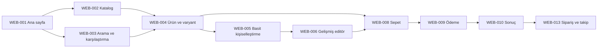
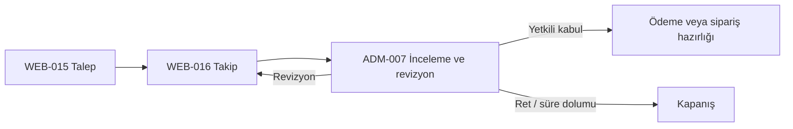

# Xinobi kanal akışları

Sürüm: 0.21.0  
Tarih: 01.10.2026  
Kapsam: Web, yönetim paneli ve Flutter mobil  
Durum: **F02-A04 teslimi — iş kuralları ve yüksek doğruluk ekranları açık**

Bu belge ekranların birbirine nasıl bağlandığını, hangi kararların akışı durdurduğunu ve sonraki fazlarda hangi katmanın sorumluluk alacağını tanımlar. Web rotaları çalışan bir prototiptir. Yönetim paneli ve mobil maddeleri akış sözleşmesidir; yüksek doğruluk ekranı veya çalışan özellik olarak kabul edilmez.

## 1. Ortak kurallar

- Web, panel ve mobil aynı sürümlü `/api/v1` sözleşmesini kullanır; kanal özelinde farklı ticari gerçek üretilmez.
- Ürün seçildikten sonra `productId` ve `variantId`; kişiselleştirmede ayrıca `designId` ile değişmez `designVersionId` sepet ve sipariş boyunca korunur.
- Fiyat, stok, rezervasyon, ödeme, teklif ve sipariş durumu için sunucu tek otoritedir. İstemci özeti kesin sonuç sayılmaz.
- Ödeme, sipariş, teklif kabulü ve entegrasyon yeniden denemeleri idempotency anahtarıyla yürütülür.
- Yetki gerektiren eylem oturum yoksa bağlamı kaybetmeden girişe yönlendirir; başarıdan sonra güvenli dönüş adresine döner.
- Yükleniyor, boş, kısmi veri, doğrulama hatası, yetkisiz, çevrimdışı, zaman aşımı ve yeniden deneme her kanalda ayırt edilir.
- Demo prototip gerçek sipariş, ödeme, stok rezervasyonu, baskı işi veya AI harcaması oluşturmaz.

Durum anahtarı:

| İşaret | Anlam |
|---|---|
| Çalışan demo | Web üzerinde gezilebilir ve otomatik test kanıtı vardır; gerçek ticari işlem değildir |
| Sözleşme | Sonraki faz için ekran, veri ve geçiş beklentisi tanımlıdır |
| Bloke | Yetkili iş kararı, sağlayıcı veya gerçek veri bekler |

## 2. Bireysel alışveriş akışı

| Adım | Ekran ve kullanıcı eylemi | Sistem sınırı / hata yolu | Durum ve bağımlılık |
|---|---|---|---|
| Keşif | WEB-001 → WEB-002 veya WEB-003; kategori, arama, sıralama ve en fazla üç ürünü karşılaştırma | Boş arama öneriyle sonuçlanır; katalog yüklenemezse yeniden dene gösterilir | Çalışan demo; gerçek katalog D02 |
| Seçim | WEB-004; ürün varyantı seçilir, WEB-007 ile favoriye alınabilir | Varyant değişince fiyat/stok yeniden istenir; geçersiz varyant sepete taşınmaz | Çalışan demo; D02 |
| Tasarım | WEB-005 → isteğe bağlı WEB-006 | Kaydedilmemiş değişiklikte çıkış uyarısı; baskı uygunluğu sunucu doğrulaması olmadan onaylanmaz | Çalışan demo; D04 |
| Sepet | WEB-008; adet ve satır düzenlenir | Her değişiklikte fiyat/stok yeniden doğrulanır; yetersiz stok ve fiyat değişimi açık gösterilir | Demo kabuk; D02, D03 |
| Kimlik/adres | WEB-011 → WEB-012 veya misafir akış kararı | Oturum süresi dolarsa sepet korunur; geçersiz adres alan bazında gösterilir | Demo kabuk; D03, D10 |
| Ödeme | WEB-009; teslimat ve ödeme yöntemi seçilir | Çift tıklama engellenir; sağlayıcı dönüşü istemci metnine değil sunucu sorgusuna göre sonuçlanır | Demo kabuk; D03, D05 |
| Sonuç | WEB-010; başarılı, başarısız veya bekleyen | Başarısız ödeme aynı siparişi çoğaltmadan yeniden denenir; havale/bekleyen başarı sayılmaz | Demo kabuk; D03, D05 |
| Takip | WEB-013; sipariş ve kargo izlenir | Sağlayıcı gecikmesinde son doğrulama zamanı ve yenileme sunulur | Demo kabuk; D03, D05 |

Giriş gereksinimi sepet öncesinde dayatılmaz. Favorinin kalıcılaştırılması, ödeme ve sipariş geçmişi için WEB-011 kullanılır. Sepet dönüş adresi yalnız uygulama içindeki izinli rotalardan seçilir.

## 3. Hesap, sipariş ve iade akışı

| Başlangıç | Normal yol | Alternatif / hata | Kapanış koşulu |
|---|---|---|---|
| WEB-011 giriş | Giriş → WEB-012 hesap | Hatalı bilgi, kilit/rate-limit, doğrulanmamış hesap | Sunucu oturumu oluşur; parola istemcide tutulmaz |
| WEB-011 kayıt | Kayıt → doğrulama → güvenli dönüş rotası | Çakışan hesap veya süresi dolmuş doğrulama | D10 onay kayıtları sürüm ve zamanla saklanır |
| WEB-011 parola yenileme | Tek kullanımlık bağlantı → yeni parola → giriş | Genel yanıtla kullanıcı varlığı sızdırılmaz | Eski oturumlar için D10/güvenlik kararı uygulanır |
| WEB-013 sipariş | Sipariş seç → kargo ve satır ayrıntısı | Boş liste, kısmi kargo bilgisi, yenileme hatası | Yetkili kullanıcı yalnız kendi kaydını görür |
| WEB-013 → WEB-014 | Uygun satır → iptal/iade nedeni → gönderim | Süre/ürün uygun değil, dosya yükleme hatası, yinelenen talep | Sunucu talep numarası döndürür; D03 ve D10 geçerlidir |

## 4. Kurumsal teklif akışı

1. WEB-015 firma, yetkili kişi, ürün/varyant, adet, kişiselleştirme ve hedef tarih bilgisini toplar.
2. Sunucu dosyaları güvenli biçimde tarar, talep numarası üretir ve WEB-016 takip görünümünü açar.
3. ADM-007 yetkili rolü talebi inceler; açıklama, fiyat kalemleri, termin, vergi ve revizyon sürümünü kaydeder.
4. Müşteri WEB-016 üzerinden sürümü görür; revizyon ister, reddeder veya yetkisi doğrulanarak kabul eder.
5. Kabul edilmiş teklif otomatik olarak ödenmiş sipariş sayılmaz. D03 ve D07 kararına göre ödeme/sipariş hazırlığı ayrı, idempotent işlemle başlar.

Teklif sürümleri geriye dönük değiştirilemez; her değişiklik yeni sürüm ve audit kaydı oluşturur. Dosya hatası, süre dolumu, yetki uyuşmazlığı ve aynı sürümün ikinci kez kabulü ayrı hata durumlarıdır. Bu akış D02, D03, D04, D05, D07 ve D10 ile blokelidir.

## 5. Kişiselleştirme, baskı ve AI akışları

### 5.1 Tasarımın yaşam döngüsü

WEB-005 basit seçimleri bir taslak olarak başlatır; WEB-006 gelişmiş düzenlemeye aynı `designId` ile geçer. Kaydetme yeni `designVersionId` üretir. Sepete yalnız sunucu tarafından doğrulanmış ürün varyantı, tasarım sürümü ve baskı uygunluk sonucu eklenebilir. Sipariş anında kullanılan tasarım sürümü sabitlenir; sonraki düzenleme eski siparişi değiştirmez. ADM-008 baskı ekibi bu sürümün üretim dosyasını ve kontrol sonucunu görür.

Zorunlu durumlar: boş taslak, kaydediliyor, kaydedildi, kaydetme hatası, çevrimdışı değişiklik, sürüm çakışması, eksik font/medya, baskı alanı ihlali, düşük kalite, uygun ve üretime kilitli. D04 kapanmadan ölçü veya fiziksel baskı garantisi verilmez.

### 5.2 AI tasarım

WEB-017 istem, tema ve palet alır; sunucu moderasyon ve limit kontrolünden sonra sağlayıcı işi başlatır. Sonuçlar alternatif kimliği ve üretim metadata'sıyla döner. Kullanıcı bir alternatifi WEB-006'ya aktarır; aktarım baskıya uygunluk veya telif onayı anlamına gelmez.

Durumlar: ilk/boş, gönderiliyor, kuyrukta, uzun sürüyor, kısmi alternatif, tamamlandı, limit aşıldı, reddedildi, sağlayıcı hatası, iptal ve güvenli yeniden deneme. Maliyet doğuran tekrar sunucu iş kimliğiyle idempotent olmalıdır. D05, D08 ve D10 blokajdır.

### 5.3 AI satış asistanı

WEB-018 kullanıcının ihtiyacını yapılandırılmış filtreye çevirir; WEB-002/003 ürün sonucuna veya WEB-015 kurumsal teklife yönlendirir. Belirsiz ya da riskli istekte açıklayıcı soru sorar veya insan desteği devri sunar. Asistan fiyat, stok, teslimat, baskı uygunluğu ya da ürün özelliği uyduramaz; kaynak verisi yoksa bunu açıklar. Konuşma saklama ve sağlayıcı aktarımı D05, D08 ve D10'a bağlıdır.

## 6. Yönetim paneli operasyon akışları

Tüm yönetim akışları ADM-002 rol/yetki kontrolünden geçer. Görüntüleme ve mutasyon izinleri ayrıdır; kritik değişiklikler önce/sonra değeri, aktör, zaman ve request ID ile audit kaydı üretir.

| Operasyon | Ekran zinciri | Başarı | Hata / geri alma | Bağımlılık |
|---|---|---|---|---|
| Operasyon özeti | ADM-001 → ilgili modül | Yetkiye göre sayaç ve iş kuyruğu | Kısmi kaynakta eski veri zamanı, yeniden dene | D02, D03, D05 |
| Rol ve ayar | ADM-002 | Yetki/ayar yeni sürümle etkin | Son yönetici kaldırılamaz; çakışmada yeniden yükle | D06, D10 |
| Katalog yayını | ADM-003 → ADM-004 → ADM-005 | Varyant, medya, fiyat ve stok doğrulanıp yayımlanır | Eksik eşleme taslakta kalır; toplu işlem kısmi sonucu gösterir | D02 |
| Sipariş/iade | ADM-006 | İzinli durum geçişi kaydedilir, bildirim/outbox üretilir | Geçersiz geçiş reddedilir; sağlayıcı sonucu ayrıca uzlaştırılır | D03, D05 |
| Teklif | ADM-007 ↔ WEB-016 | Yeni değişmez teklif sürümü yayımlanır | Yetkisiz kabul ve eski sürüm reddedilir | D07, D10 |
| Baskı | ADM-008 | Onaylı tasarım sürümü üretime kilitlenir | Kalite/alan ihlaliyle durdurulur; yeniden yükleme yeni sürümdür | D04 |
| İçerik | ADM-009 → WEB-019/020 | Önizleme, zamanlama ve kontrollü yayın | Hatalı yayın önceki sürüme döndürülür | D10 |
| Mikro | ADM-010 | Eşleme + outbox gönderimi + uzlaştırma | Aynı kayıt idempotent tekrar; zehirli mesaj ayrı kuyruğa | D02, D03, D05, D06 |
| Pazaryeri | ADM-011 | Kanal eşleme ve sonuç uzlaştırma | Rate-limit/backoff, kısmi hata, elle yeniden dene auditli | D02, D03, D05, D06 |
| AI yönetimi | ADM-012 | Sağlayıcı, limit ve politika sürümü etkinleşir | Secret gösterilmez; maliyet/limit taşmasında devre kesici | D05, D08, D10 |

Panel için ADM-001–012 yüksek doğruluk ekranları ve etkileşimleri henüz üretilmemiştir; bu tablo uygulama kabulü değildir.

## 7. Flutter mobil eşliği

| Mobil kapsam | Web karşılığı | Mobil davranış | Açık bağımlılık |
|---|---|---|---|
| MOB-001 ana sayfa/katalog/ürün | WEB-001–004, WEB-007 | Alt/üst navigasyon, pull-to-refresh, liste geri dönüşünde filtre/konum koruma | D02 |
| MOB-002 editör | WEB-005–006 | Güvenli alan, klavye/araç çakışması, dokunmatik seçim; ağır araçlar için açık eşlik kararı | D04, D09 |
| MOB-003 sepet/ödeme | WEB-008–010 | Uygulamadan sağlayıcıya gidiş ve deep-link dönüşünde sunucu doğrulaması | D03, D05, D09 |
| MOB-004 hesap/sipariş | WEB-011–014 | Biyometri yalnız oturum kilidi; sistem geri hareketi taslağı yanlışlıkla kaybetmez | D03, D09, D10 |
| MOB-005 teklif | WEB-015–016 | Dosya seçici, yükleme ilerlemesi ve revizyon bildirimi | D07, D09, D10 |
| MOB-006 AI/bildirim | WEB-017–018 | Uzun iş arka plana geçerse push/deep-link ile doğru iş ve ekrana dönüş | D05, D08, D09, D10 |

iOS güvenli alanı ve geri hareketi; Android sistem geri davranışı; ekran klavyesi; izin reddi; düşük bağlantı, çevrimdışı ve uygulama yeniden başlatma ayrı kabul senaryolarıdır. Push bildirimi yalnız yetkili hedefe, geçerli ve izinli deep link ile gider. MOB-001–006 şu anda sözleşmedir; iOS/Android referans ekranları ve Flutter uygulama kabulü açık F02 işidir.

## 8. Kanal geçişleri ve durum uzlaştırma

WEB-019 kurumsal içerik keşif akışının bilgi girişidir; CTA'lar yalnız mevcut katalog, teklif ve destek rotalarına gider. WEB-020 yasal merkez ve çerez tercihleri tüm kanalları keser: zorunlu olmayan izin reddi temel alışverişi engellemez, tercih değişikliği sonraki ölçüm/iletişim işlemlerine uygulanır ve yürürlükteki metin sürümü D10 kararıyla kaydedilir.

| Olay | Kanal davranışı | Sunucu davranışı |
|---|---|---|
| Başka cihazda sepet değişti | Yerel özet kesin kabul edilmez; birleşim sonucu açıklanır | Sürüm/ETag ile çakışmayı belirler, güncel fiyat/stok döndürür |
| Ödeme dönüşü kayboldu | WEB-010 veya MOB-003 işlem kimliğiyle yeniden sorgular | Sağlayıcı webhook + sorgu sonucu uzlaştırılır; sipariş çoğalmaz |
| Yönetici durum değiştirdi | WEB-013/MOB-004 yenilemede yeni durumu gösterir | İzinli geçiş, audit ve outbox tek işlem sınırında tutulur |
| Entegrasyon gecikti | Son doğrulama zamanı ve bekleyen durum görünür | ADM-010/011 üzerinden idempotent retry ve dead-letter işletilir |
| Oturum süresi doldu | Hassas içerik gizlenir; güvenli giriş dönüşü sunulur | Yetkisiz isteği standart Problem Details ile reddeder |
| Çevrimdışı düzenleme | Otomatik ticari işlem yapılmaz; taslak/senkron durumu açık gösterilir | Çakışmada sürümler korunur, sessiz ezme yapılmaz |

## 9. Uygulama ve kabul sahipliği

| Teslim | Sonraki faz | Birincil sahip | Kabul kanıtı |
|---|---|---|---|
| API, kimlik, hata ve idempotency sözleşmesi | Faz03 | BE + Full Stack | Sözleşme ve entegrasyon testleri |
| Ürün, varyant, fiyat, stok ve sepet | Faz04–05 | BE + FE + DBA | D02 kararı, API/UI/UAT |
| Tasarım, baskı ve AI | Faz06 | FE + BE + Creative | D04/D05/D08, kalite ve sağlayıcı testleri |
| Ödeme, sipariş, teklif ve iade | Faz07 | BE + FE + İş Analisti | D03/D07, sandbox ve UAT |
| Mikro ve pazaryeri | Faz08 | Entegrasyon + BE | D05/D06, tekrar/uzlaştırma testleri |
| Admin, CMS ve operasyon | Faz09 | FE + BE | Rol/audit ve görev bazlı UAT |
| Flutter eşliği | Faz10 | Flutter + BE + Creative | D09, iOS/Android cihaz testleri |
| Güvenlik, performans ve yayın | Faz11 | Tüm teknik roller + PM | D10, a11y, yük, güvenlik ve geri dönüş kanıtı |

F02-A04 bu akışların belge düzeyindeki bağlantısını tamamlar. Gerçek iş kuralları, panel/mobil yüksek doğruluk tasarımları, API uygulaması ve rol/PM kabulü kendi açık teslimleri kapanmadan tamamlanmış sayılmaz.
